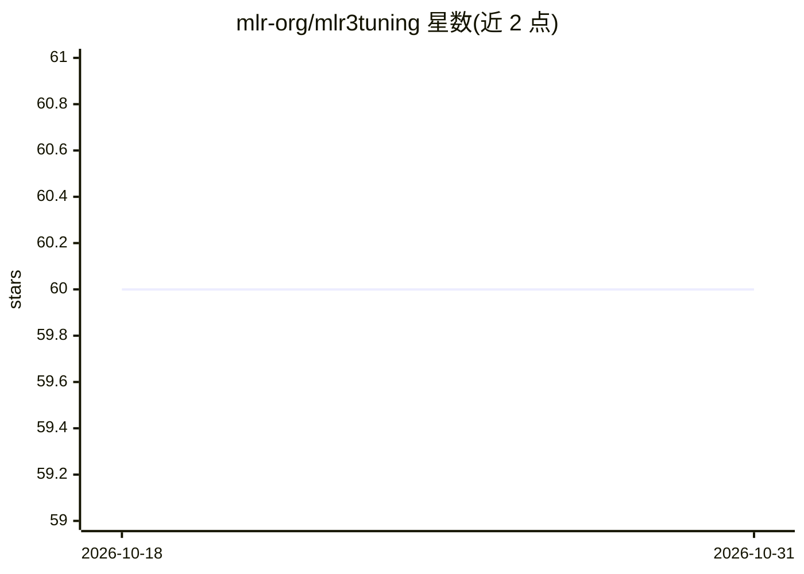

# mlr-org/mlr3tuning

⭐ 60 · R · LGPL-3.0 · 推送 2026-09-23 · [GitHub](https://github.com/mlr-org/mlr3tuning) · [官网](https://mlr3tuning.mlr-org.com/) · 组织维护

**面向 mlr3 生态的 R 超参数优化包**

mlr3 生态的超参数优化 R 包：通过 paradox 包定义可配置搜索空间，为任意 mlr3 learner 寻找最优超参数配置，支持 Random Search、网格搜索、Iterated Racing、贝叶斯优化（mlr3mbo）与 Hyperband（mlr3hyperband）等算法，基于 bbotk 优化框架构建，可用嵌套重采样估计优化后模型性能。配套扩展包提供文献搜索空间与算法补充；从 CRAN 或 GitHub 安装，面向使用 mlr3 的机器学习研究与实践者。

## 筛选速览

| 维度 | 判定 | 备注 |
|---|---|---|
| AI 角色 | `ai-ecosystem` | LLM/agent 周边工具 |
| 许可风险 | `viral` | LGPL-3.0 |
| 部署形态 | `None` |  |
| 模型依赖 | — | README 未给出锁定关系 |
| 硬件要求 | — | 无带数字的原话,不猜 |
| 安装摩擦 | `low` | 无编译、无系统依赖或容器化 |
| 成熟度 | — | 结构信号不足 |

## 能力要点

- 通过 paradox 定义高度可配置的搜索空间
- 支持多种优化算法：随机/网格搜索、Iterated Racing、贝叶斯优化、Hyperband
- 嵌套重采样估计优化后模型性能
- 扩展包 mlr3tuningspaces 提供来自文献的搜索空间

## 适用场景

- 为 mlr3 learner 自动调优超参数
- 用嵌套重采样无偏估计调优后模型性能
- 复用文献中的搜索空间做基线或对比实验

## 场景标签

`MLOps` · 领域:训练与推理

## 证据(README 行号)

> L12: *mlr3tuning* is the hyperparameter optimization package of the
> L16: learner. mlr3tuning works
> L26: The package is built on the optimization framework

## 星数曲线

2026-10-18 60 → 2026-10-31 60（+0）

---
*卡片 v1 · prompt 1.4 · 生成 2026-10-24 · 置信度 high · 依据 README sha `f36a70aeefbd` · [字段定义](../../DATASET.md)*
