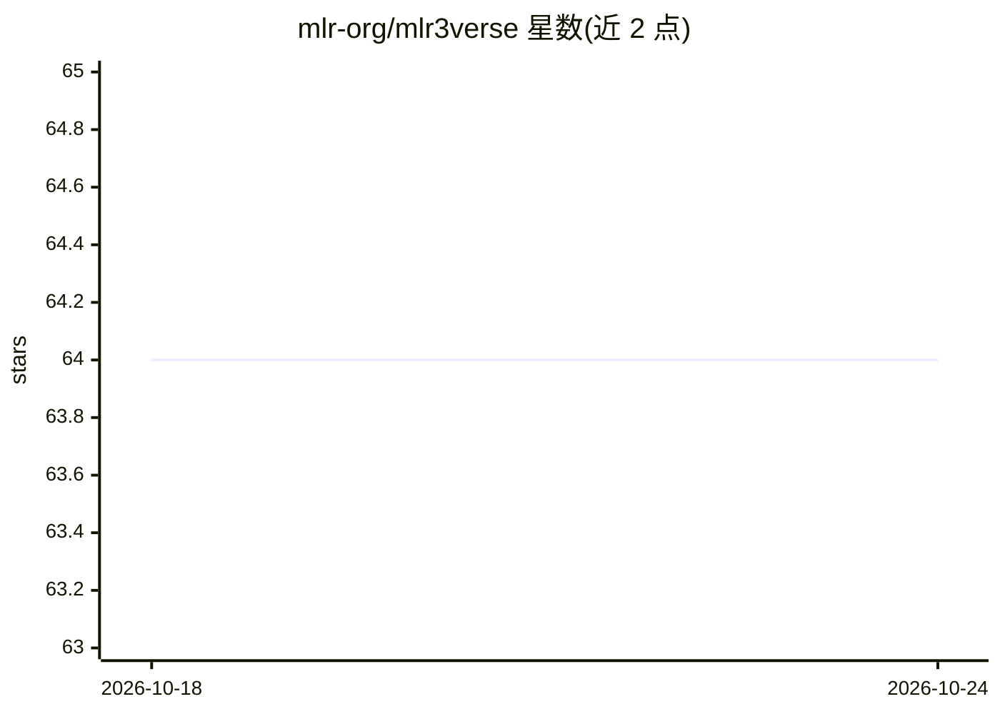

# mlr-org/mlr3verse

⭐ 64 · R · LGPL-3.0 · 推送 2026-09-23 · [GitHub](https://github.com/mlr-org/mlr3verse) · [官网](https://mlr3verse.mlr-org.com) · 组织维护

**mlr3 生态系统核心包的安装与加载元包**

R 语言的 meta-package，用于一次性安装和加载 mlr3 机器学习生态的核心扩展包。它不直接附加各扩展包，而是重新导出常用函数，提供访问 mlr3 核心功能的轻量接口；导入 mlr3 本体及聚类、特征选择、流水线预处理、深度学习、超参调优、可视化等 12 个包，另可按依赖方式安装公平性审计、时序预测、空间分析等 13 个附加包。面向使用 mlr3 做回归、分类、聚类与生存分析任务的 R 用户，可从 CRAN 或 GitHub 安装。

## 筛选速览

| 维度 | 判定 | 备注 |
|---|---|---|
| AI 角色 | `ai-ecosystem` | LLM/agent 周边工具 |
| 许可风险 | `viral` | LGPL-3.0 |
| 部署形态 | `None` |  |
| 模型依赖 | — | README 未给出锁定关系 |
| 硬件要求 | — | 无带数字的原话,不猜 |
| 安装摩擦 | `low` | 无编译、无系统依赖或容器化 |
| 成熟度 | — | 结构信号不足 |

## 能力要点

- 一条命令安装/加载 mlr3 生态 12 个核心包
- 重新导出常用函数，避免逐个 attach 扩展包
- mlr3verse_info() 查看已加载包信息
- 可选依赖安装 13 个附加包（公平性、时序、空间等）

## 适用场景

- 在 R 中一站式搭建 mlr3 机器学习工作流
- 通过统一入口使用 mlr3 的调优、特征选择与流水线功能
- 按需扩展公平性审计、时间序列预测等能力

## 场景标签

`MLOps` · 领域:训练与推理

## 证据(README 行号)

> L4: Meta-package for installing and using core [mlr3
> L17: This package simplifies installing and loading packages from the mlr3

## 星数曲线

2026-10-18 64 → 2026-10-24 64（+0）

---
*卡片 v1 · prompt 1.4 · 生成 2026-10-24 · 置信度 high · 依据 README sha `af453003d329` · [字段定义](../../DATASET.md)*
