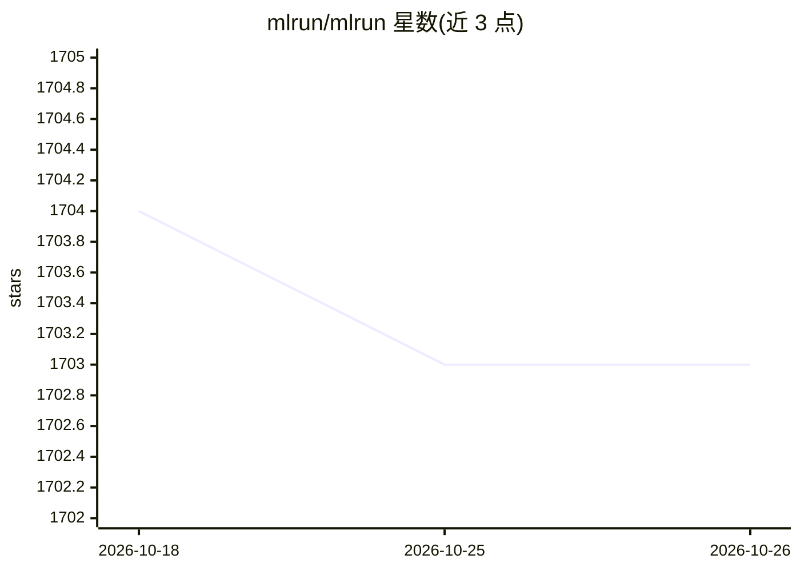

# mlrun/mlrun

⭐ 1,703 · Python · Apache-2.0 · 推送 2026-10-25 · [GitHub](https://github.com/mlrun/mlrun) · [官网](https://mlrun.org) · 组织维护

**面向企业的开源 MLOps/GenAI 编排平台，覆盖全生命周期**

MLRun 是开源 AI 编排平台，用于构建和管理持续运行的（生成式）AI 应用，覆盖数据管理、开发训练、模型部署与线上运维监控等阶段。核心组件包括项目管理服务、函数自动部署、数据与工件目录/版本化、批处理与工作流、实时 Serverless 服务管道、模型监控与告警、特征存储。以 Python 包提供（PyPI），支持 Kubernetes/Nuclio Serverless 弹性扩缩，集成开发与 CI/CD 环境。面向需要在企业内规模化交付 ML 管道与在线应用的工程团队。

## 筛选速览

| 维度 | 判定 | 备注 |
|---|---|---|
| AI 角色 | `ai-ecosystem` | LLM/agent 周边工具 |
| 许可风险 | `permissive` | Apache-2.0 |
| 部署形态 | `library` | 以包/库形式分发 |
| 模型依赖 | — | README 未给出锁定关系 |
| 硬件要求 | — | 无带数字的原话,不猜 |
| 安装摩擦 | `low` | 无编译、无系统依赖或容器化 |
| 成熟度 | — | 结构信号不足 |

## 能力要点

- 覆盖数据→训练→部署→监控的 ML/GenAI 全生命周期编排
- 基于 Nuclio Serverless 函数的实时弹性服务管道
- 特征存储与数据/工件版本化、血缘管理
- 内建模型监控：漂移检测、告警、再训练触发

## 适用场景

- 构建并自动化端到端 ML 训练与部署管道
- 将 LLM 作为 Serverless 函数部署为实时服务
- 监控生产环境模型性能与数据漂移

## 场景标签

`MLOps` `推理引擎` · 领域:训练与推理

## 证据(README 行号)

> L16: MLRun is an open source AI orchestration platform for quickly building and managing continuous (gen) AI application
> L112: MLRun allows you to easily build ML pipelines that take data from various sources or the Feature Store and process
> L120: MLRun rapidly deploys and manages production-grade real-time or batch application pipelines using elastic and resi

## 星数曲线

2026-10-18 1,704 → 2026-10-26 1,703（-1）

---
*卡片 v1 · prompt 1.4 · 生成 2026-10-21 · 置信度 high · 依据 README sha `923e373ae3d7` · [字段定义](../../DATASET.md)*
