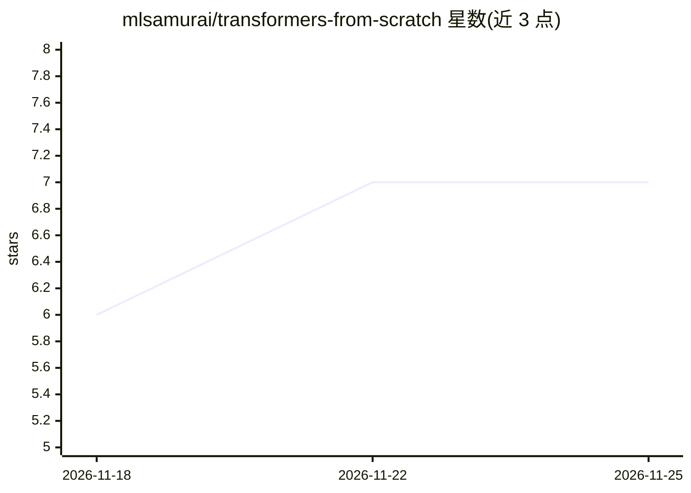

# mlsamurai/transformers-from-scratch

⭐ 7 · Jupyter Notebook · MIT · 推送 2026-11-17 · [GitHub](https://github.com/mlsamurai/transformers-from-scratch) · [官网](https://blog.korolevalab.com/teaching/transformers-from-scratch/) · 个人维护

**十个 notebook 的免费课程：从零写 PyTorch 翻译器到上线**

共十课的开源课程，用 PyTorch 从 tokenizer 起步手写一个英俄翻译器，覆盖 BPE、encoder–decoder、beam search 解码、chrF/COMET 评测、RoPE/RMSNorm/SwiGLU 改造、W&B 超参搜索、打包与 CI、FastAPI 服务、可复现 Docker 镜像与蒸馏。每课是可在 Kaggle/Colab 免费 GPU 上运行的 notebook，配套博客文章；课程间通过共享 tokenizer 与 checkpoint 衔接，可单独打开任一课。要求读者会 Python，从第 2 课起最好有 PyTorch 基础。

## 筛选速览

| 维度 | 判定 | 备注 |
|---|---|---|
| AI 角色 | `ai-knowledge` | 知识聚合/清单类 |
| 许可风险 | `permissive` | MIT |
| 部署形态 | `None` |  |
| 模型依赖 | — | README 未给出锁定关系 |
| 硬件要求 | — | 无带数字的原话,不猜 |
| 安装摩擦 | `low` | 无编译、无系统依赖或容器化 |
| 成熟度 | — | 结构信号不足 |

## 能力要点

- 从零实现 BPE tokenizer 与 Transformer encoder–decoder
- chrF/COMET/BLEU 评测与配对 bootstrap 显著性检验
- 打包、测试、CI、FastAPI 服务与可复现 Docker 镜像全流程
- 每课 notebook 可在 Kaggle/Colab 免费 GPU 上运行

## 适用场景

- 系统学习 Transformer 从原理到部署的完整流程
- 学习机器翻译评测与数据泄漏检验方法
- 参考如何将 notebook 模型打包为可复现的生产镜像

## 场景标签

`教程课程` · 领域:学习与行业

## 证据(README 行号)

> L3: A free course in ten lessons. We write an English–Russian translator in PyTorch, starting from the tokenizer, and
> L6: Every lesson is a notebook that runs on a free GPU on Kaggle or Colab, and a post on
> L11: ## Lessons

## 星数曲线

2026-11-18 6 → 2026-11-25 7（+1）

---
*卡片 v1 · prompt 1.4 · 生成 2026-11-20 · 置信度 high · 依据 README sha `78433bc9c9a8` · [字段定义](../../DATASET.md)*
