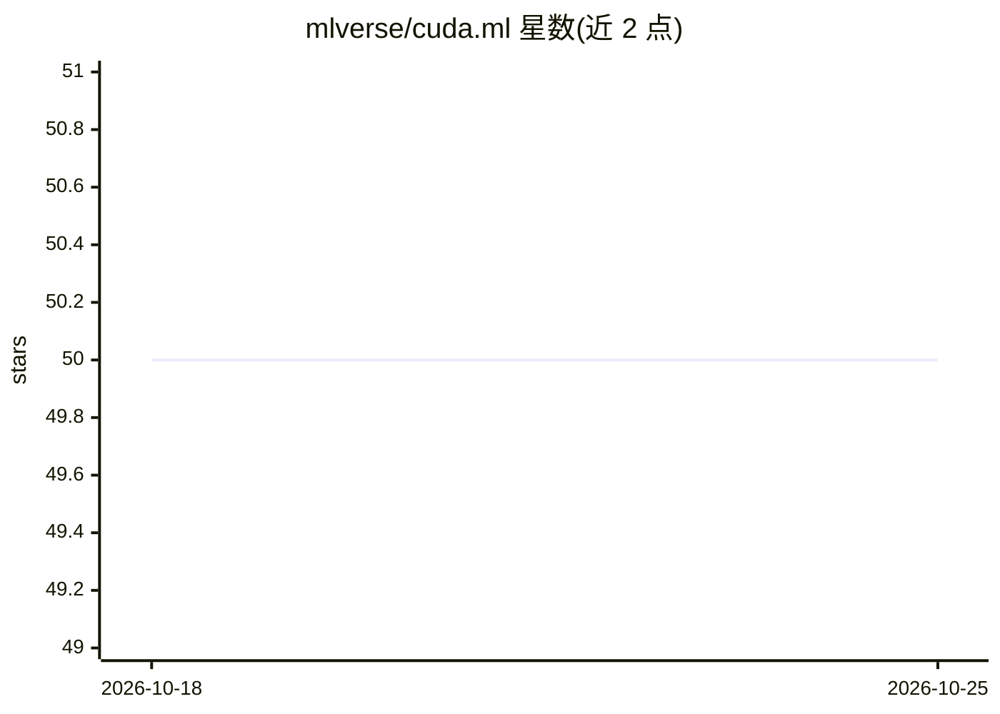

# mlverse/cuda.ml

⭐ 50 · R · NOASSERTION · 推送 2026-08-31 · [GitHub](https://github.com/mlverse/cuda.ml) · [官网](https://mlverse.github.io/cuda.ml/) · 组织维护

**RAPIDS cuML 的 R 接口包：在 R 中调用 GPU 加速机器学习算法**

R 语言包，封装 RAPIDS cuML 的 GPU 加速机器学习算法：聚类（DBSCAN、K-Means）、降维（PCA、UMAP、t-SNE 等）、线性/非线性回归与分类、KNN、SVM，以及 nvForest 随机森林推理。CRAN 包不含编译代码，安装后调用 cuda_ml_install() 下载固定的 CUDA/cuML/nvForest/Treelite 原生后端（约 1.6 GiB），并提供 CPU-only 推理后端。原生操作要求 Linux x86_64（glibc≥2.28），GPU 操作需 NVIDIA GPU 与 580 及以上驱动。提供 parsnip/tidymodels 绑定。

## 筛选速览

| 维度 | 判定 | 备注 |
|---|---|---|
| AI 角色 | `ai-native` | 本体是模型或模型工具 |
| 许可风险 | `none` | NOASSERTION |
| 部署形态 | `None` |  |
| 模型依赖 | — | README 未给出锁定关系 |
| 硬件要求 | `cpu-ok` | |
| 安装摩擦 | `medium` | 含编译或系统依赖之一 |
| 成熟度 | `idea` | |

## 能力要点

- R 接口覆盖聚类、降维、线性/非线性模型、KNN、SVM 等 cuML 算法子集
- cuda_ml_install() 下载固定版本原生后端（CUDA 13.2.2 / cuML 26.06），CRAN 包不含编译代码
- 提供仅 CPU 的 nvForest 推理后端（免 CUDA）
- 提供 parsnip/tidymodels 绑定用于监督学习任务

## 适用场景

- R 用户在 GPU 上运行 K-Means、UMAP、t-SNE 等机器学习算法
- 通过 parsnip/tidymodels 工作流使用 GPU 加速建模
- 用 UMAP/t-SNE 可视化高维数据聚类结构

## 场景标签

 · 领域:机器学习/R 语言生态

## 证据(README 行号)

> L6: The goal of {cuda.ml} is to provide a simple and intuitive R interface
> L8: suite of GPU-accelerated machine learning libraries powered by
> L9: CUDA. {cuda.ml} is under active

## 星数曲线

2026-10-18 50 → 2026-10-25 50（+0）

---
*卡片 v1 · prompt 1.4 · 生成 2026-10-24 · 置信度 high · 依据 README sha `5bd470a3652c` · [字段定义](../../DATASET.md)*
