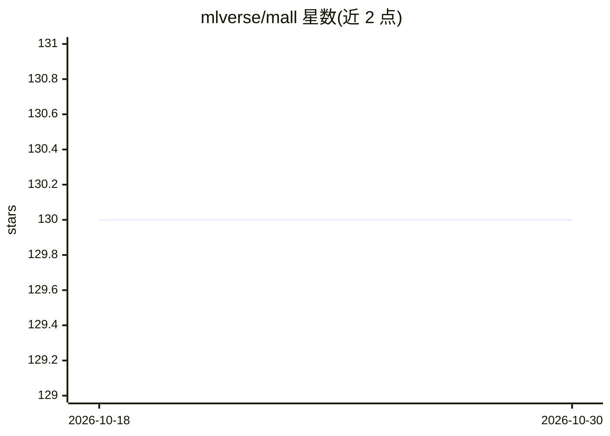

# mlverse/mall

⭐ 130 · R · 推送 2026-05-21 · [GitHub](https://github.com/mlverse/mall) · [官网](https://mlverse.github.io/mall/) · 组织维护

**R/Python 库：对数据框逐行批量运行 LLM 预测**

mall 提供 R 与 Python 双语言接口，对数据框指定列逐行运行多个 LLM 预测：使用预先确定的一次性提示词，结合当前行内容生成预测结果。定位为数据处理场景下的批量 LLM 调用工具，自述处于 experimental 生命周期阶段，安装与用法细节托管在官方文档站点。适合需要在表格数据流水线中嵌入 LLM 处理的开发者。

## 筛选速览

| 维度 | 判定 | 备注 |
|---|---|---|
| AI 角色 | `ai-ecosystem` | LLM/agent 周边工具 |
| 许可风险 | `none` | — |
| 部署形态 | `None` |  |
| 模型依赖 | — | README 未给出锁定关系 |
| 硬件要求 | — | 无带数字的原话,不猜 |
| 安装摩擦 | `low` | 无编译、无系统依赖或容器化 |
| 成熟度 | `idea` | |

## 能力要点

- R 与 Python 双语言可用
- 对数据框指定列逐行处理 LLM 预测
- 一次性提示词与行内容组合的调用机制

## 适用场景

- 在数据流水线中批量对文本列做 LLM 分类或抽取
- 用 R 或 Python 对数据框逐行生成 LLM 预测结果

## 场景标签

`数据分析` · 领域:效率与自动化

## 证据(README 行号)

> L8: Run multiple LLM predictions against a data frame. The predictions are
> L11: `mall` is now available in both R and Python.

## 星数曲线

2026-10-18 130 → 2026-10-30 130（+0）

---
*卡片 v1 · prompt 1.4 · 生成 2026-10-23 · 置信度 high · 依据 README sha `6f5b86d7a8a1` · [字段定义](../../DATASET.md)*
