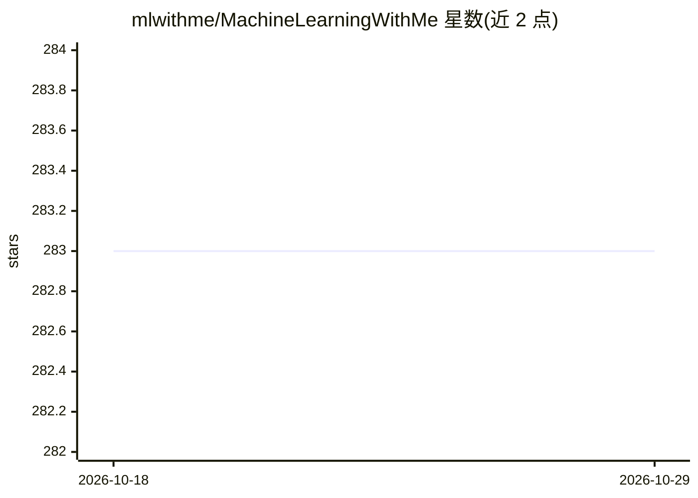

# mlwithme/MachineLearningWithMe

⭐ 283 · Jupyter Notebook · 推送 2026-07-11 · [GitHub](https://github.com/mlwithme/MachineLearningWithMe) · 组织维护 · 中文 README

**机器学习算法原理与从零实现的教程仓库（配书/视频）**

「跟我学机器学习」出品的教程型仓库，内容覆盖线性回归、逻辑回归、K近邻、朴素贝叶斯、决策树、集成学习（随机森林/AdaBoost/GBDT）、SVM、聚类、PCA 降维、标签传播等 10 余种经典统计机器学习算法，每章包含原理推导、sklearn 接口示例与从零实现代码，部分章节带实例（手写体识别、垃圾邮件分类、泰坦尼克生还预测）。内容以在线阅读站点与出版书籍形式提供，第 1 章指导 Conda 环境配置。面向机器学习初学者与教学场景。

## 筛选速览

| 维度 | 判定 | 备注 |
|---|---|---|
| AI 角色 | `ai-knowledge` | 知识聚合/清单类 |
| 许可风险 | `none` | — |
| 部署形态 | `None` |  |
| 模型依赖 | — | README 未给出锁定关系 |
| 硬件要求 | — | 无带数字的原话,不猜 |
| 安装摩擦 | `low` | 无编译、无系统依赖或容器化 |
| 成熟度 | — | 结构信号不足 |

## 能力要点

- 覆盖 10 余种经典统计机器学习算法的原理推导与从零实现
- 各算法同时提供 sklearn 接口示例与手写实现
- 配套实例项目（手写体识别、垃圾邮件分类、泰坦尼克生还预测）
- 提供在线阅读站点与中英文 README

## 适用场景

- 系统学习经典机器学习算法的原理与推导过程
- 参照从零实现代码理解算法内部机制
- 按章节跟随完成配套实战练习

## 场景标签

`教程课程` · 领域:学习与行业

## 证据(README 行号)

> L7: ### 在线阅读：跟我学机器学习 www.machinelearningwithme.com
> L11: ### 第0节 机器学习入门导读

## 星数曲线

2026-10-18 283 → 2026-10-29 283（+0）

---
*卡片 v1 · prompt 1.4 · 生成 2026-10-22 · 置信度 high · 依据 README sha `aa4116a3344a` · [字段定义](../../DATASET.md)*
