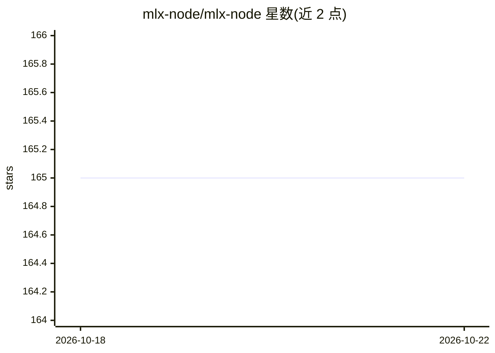

# mlx-node/mlx-node

⭐ 165 · Rust · MIT · 推送 2026-10-21 · [GitHub](https://github.com/mlx-node/mlx-node) · [官网](https://mlx.void.app) · 组织维护

**Node.js 运行 MLX 模型的推理/训练工具链**

在 Node.js 中运行 Apple MLX 模型的工具集：提供语言、视觉、语音、嵌入模型推理，OpenAI/Anthropic 风格端点的 HTTP 服务器（含连续批处理、分页 KV 缓存），模型转换与 GGUF K-quant 导入，以及 GRPO/SFT 训练器和本地编码 agent。主要目标平台是 Apple Silicon + Metal，另有面向 NVIDIA GB10/DGX Spark 的实验性 CUDA 后端（仅推理）。原生层为 Rust/C++，运行时不依赖 Python。通过 npm 安装 CLI 或各子包。

## 筛选速览

| 维度 | 判定 | 备注 |
|---|---|---|
| AI 角色 | `ai-ecosystem` | LLM/agent 周边工具 |
| 许可风险 | `permissive` | MIT |
| 部署形态 | `library` | 以包/库形式分发 |
| 模型依赖 | local-ok | 支持本地模型 |
| 硬件要求 | — | 无带数字的原话,不猜 |
| 安装摩擦 | `medium` | 含编译或系统依赖之一 |
| 成熟度 | `idea` | |

## 能力要点

- TypeScript 公共 API，原生层 Rust/C++，运行时无需 Python
- HTTP 服务器实现 /v1/responses、/v1/messages、音频转写与合成等端点
- GRPO/SFT 训练（dapo/dr_grpo/bnpo 损失、检查点续训）
- GGUF K-quant 无损重打包为 MLX 布局，本地 PII 检测与编辑包

## 适用场景

- 在 Apple Silicon 上用 Node.js 跑本地 LLM 推理与 HTTP 服务
- 对 Qwen 等模型做 GRPO/SFT 本地微调并带 TUI 监控
- 构建本地编码 agent 或文档/OCR 处理流水线

## 场景标签

`微调` `强化学习` `模型量化` · 领域:训练与推理

## 证据(README 行号)

> L8: MLX-Node runs MLX models from Node.js. It includes language and multimodal inference, an HTTP server, model conversi
> L10: The main target is Apple Silicon with Metal. There is also an experimental CUDA backend for Linux on NVIDIA GB10 / 

## 星数曲线

2026-10-18 165 → 2026-10-22 165（+0）

---
*卡片 v1 · prompt 1.4 · 生成 2026-10-22 · 置信度 high · 依据 README sha `d5535ac5fbf2` · [字段定义](../../DATASET.md)*
