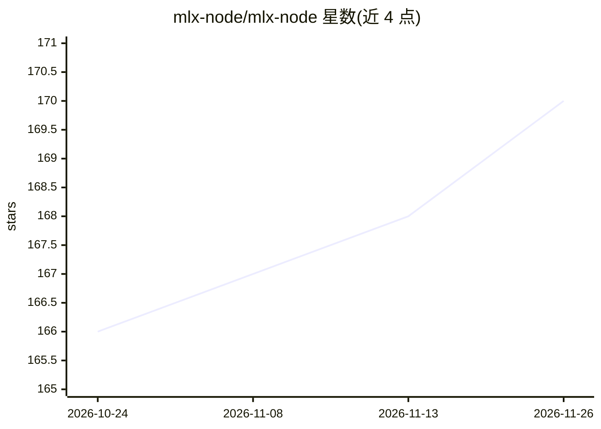

# mlx-node/mlx-node

⭐ 170 · Rust · MIT · 推送 2026-11-25 · [GitHub](https://github.com/mlx-node/mlx-node) · [官网](https://mlx.void.app) · 组织维护

**在 Node.js 中运行 MLX 模型的推理/训练运行时**

从 Node.js 运行 MLX 模型的工具集，包含语言与多模态推理、HTTP 服务器、模型转换及 GRPO/SFT 训练，公开 API 为 TypeScript，原生层由 Rust 和 C++ 构成，运行时不依赖 Python。CLI 需 Node.js 22.19+，预编译二进制要求 Apple Silicon 上的 macOS 26+；CUDA 路径仅限 Linux aarch64/GB10 与 Windows ARM64 源码构建且为实验性。模型目录覆盖 Qwen、Gemma、DeepSeek、OCR、ASR、TTS、嵌入与重排等型号，服务器实现 OpenAI/Anthropic 风格端点并支持连续批处理。

## 筛选速览

| 维度 | 判定 | 备注 |
|---|---|---|
| AI 角色 | `ai-ecosystem` | LLM/agent 周边工具 |
| 许可风险 | `permissive` | MIT |
| 部署形态 | `library` | 以包/库形式分发 |
| 模型依赖 | — | README 未给出锁定关系 |
| 硬件要求 | — | 无带数字的原话,不猜 |
| 安装摩擦 | `high` | 编译与系统依赖俱全 |
| 成熟度 | — | 结构信号不足 |

## 能力要点

- 从 Node.js 运行 MLX 模型，运行时无需 Python
- mlx serve 提供多端点 HTTP 服务器，支持连续批处理与 SSE 背压
- 包含 GRPO（多种 loss）与 SFT 训练包
- 支持语言、视觉/OCR、ASR、TTS、嵌入与重排多类模型

## 适用场景

- 在 macOS/Apple Silicon 上本地部署 LLM 推理服务
- 用 TypeScript 库构建带工具调用与流式输出的聊天会话
- 在 Apple Silicon 上做 GRPO/SFT 微调
- 本地运行 OCR、语音转写与文档处理流水线

## 场景标签

`推理引擎` `微调` `强化学习` · 领域:训练与推理

## 证据(README 行号)

> L8: MLX-Node runs MLX models from Node.js. It includes language and multimodal inference, an HTTP server, model conversi
> L10: The main target is Apple Silicon with Metal. CUDA source builds are available for Linux on NVIDIA DGX Spark and Win
> L19: mlx serve --port 8080

## 星数曲线

2026-10-24 166 → 2026-11-26 170（+4）

---
*卡片 v1 · prompt 1.4 · 生成 2026-11-26 · 置信度 high · 依据 README sha `d58c8f20b962` · [字段定义](../../DATASET.md)*
