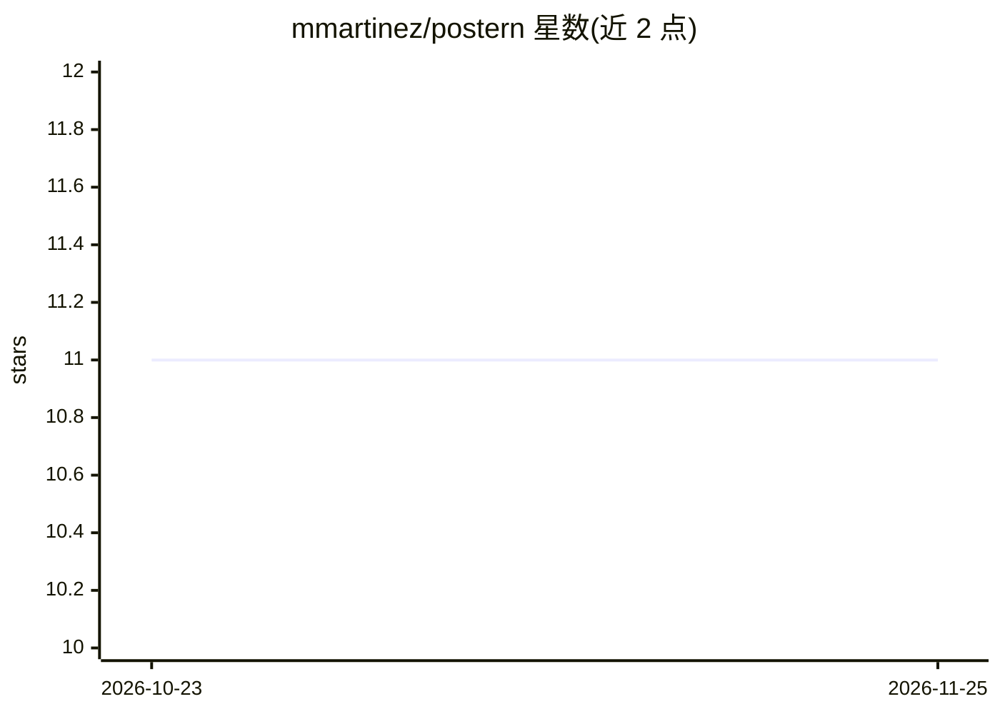

# mmartinez/postern

⭐ 11 · Go · Apache-2.0 · 推送 2026-11-19 · [GitHub](https://github.com/mmartinez/postern) · 个人维护

**为 AI agent 代管 1Password/Bitwarden 凭据的 HTTPS 代理**

一个凭据代管 HTTPS 正向代理：agent 发送不带 API key 的请求，Postern 按目标主机匹配 YAML 规则，从 1Password/Bitwarden 保险库或 IdP（OAuth2 短期令牌）解析凭据并注入出站请求。凭据提供方可插拔（op://、bw://、keychain://、oauth2:// 等 scheme）。无法解析时以 502 fail-closed。限制：仅支持 HTTP/1.1（HTTP/2-only 客户端如 gRPC 不可用），Windows 暂缓，处于早期开发阶段。以 Go 二进制、容器镜像形式分发，附带供 agent 加载的 SKILL.md 安装技能包。

## 筛选速览

| 维度 | 判定 | 备注 |
|---|---|---|
| AI 角色 | `ai-ecosystem` | LLM/agent 周边工具 |
| 许可风险 | `permissive` | Apache-2.0 |
| 部署形态 | `self-host` | docker 或自建部署 |
| 模型依赖 | — | README 未给出锁定关系 |
| 硬件要求 | — | 无带数字的原话,不猜 |
| 安装摩擦 | `low` | 无编译、无系统依赖或容器化 |
| 成熟度 | `idea` | |

## 能力要点

- 从 1Password/Bitwarden 保险库或 IdP 在请求时解析并注入凭据，agent 环境不持有任何密钥
- 凭据提供方可插拔，新增 provider 为一个包加一个 import
- 凭据无法解析时 fail-closed（502）且不联系上游
- 附带 SKILL.md agent 技能包引导完整安装流程

## 适用场景

- 让 AI agent 调用需认证的 API 而不在其环境中存放 API key
- 用短期 OAuth2 令牌替代长期密钥降低泄露风险
- 将密钥注入从 agent 代码中剥离、集中到代理规则管理

## 场景标签

`网络安全` · 领域:学习与行业

## 证据(README 行号)

> L10: Postern is a credential-brokering HTTPS proxy. **One proxy, two credential
> L43: Your agent makes a normal request through the proxy, with **no `Authorization`
> L63: The agent points `HTTPS_PROXY` at postern and trusts its local CA. For each

## 星数曲线

2026-10-23 11 → 2026-11-25 11（+0）

---
*卡片 v1 · prompt 1.4 · 生成 2026-11-18 · 置信度 high · 依据 README sha `be36ef3ddcb3` · [字段定义](../../DATASET.md)*
