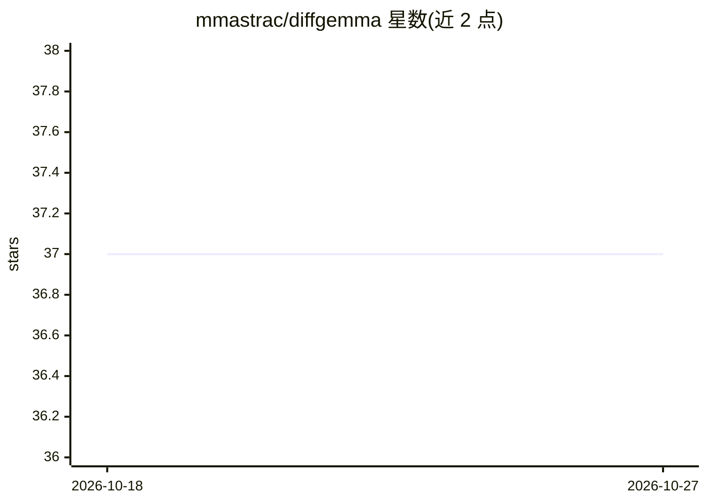

# mmastrac/diffgemma

⭐ 37 · Rust · 推送 2026-09-18 · [GitHub](https://github.com/mmastrac/diffgemma) · 个人维护

**Rust+Metal 实现的 DiffusionGemma 26B 文本扩散推理引擎，面向 Apple Silicon**

用纯 Rust 实现的 DiffusionGemma 26B-A4B-it（Gemma-4 MoE、离散块扩散）推理引擎，在 Apple Silicon 上通过 Metal 后端并行去噪 256-token 画布生成文本。提供 one-shot 询问、交互式聊天、OpenAI 兼容 HTTP 服务（含 JSON schema 结构化决策模式）与自主量化（q4/q6/NVFP4）。限制：需 macOS Apple Silicon、最少 36 GB 统一内存，仅文本（视觉塔未移植），自述为进行中项目；CUDA 后端目前仅覆盖可移植内核层与 nanogpt 示例，26B 引擎仍为 Metal-only。

## 筛选速览

| 维度 | 判定 | 备注 |
|---|---|---|
| AI 角色 | `ai-native` | 本体是模型或模型工具 |
| 许可风险 | `none` | — |
| 部署形态 | `library` | 以包/库形式分发 |
| 模型依赖 | — | README 未给出锁定关系 |
| 硬件要求 | — | 无带数字的原话,不猜 |
| 安装摩擦 | `high` | 编译与系统依赖俱全 |
| 成熟度 | `idea` | |

## 能力要点

- 块扩散解码：并行去噪 256-token 画布而非逐 token 生成
- OpenAI 兼容 HTTP 服务与 JSON schema 结构化决策（多次读取均值与标准误）
- diffgemma download 拉取并校验预量化 .dgq 包，支持 q4/q6/NVFP4 自主量化
- 可从 opencode 作为 provider 直接调用

## 适用场景

- 在 Mac 上本地运行 DiffusionGemma 26B 做对话与问答
- 把本地扩散模型以 OpenAI API 形式提供给 opencode 等客户端
- 用 JSON schema 让模型输出带置信度的结构化决策
- 对 bf16 权重做自定义量化以适配内存规格

## 场景标签

`推理引擎` `模型量化` · 领域:训练与推理

## 证据(README 行号)

> L3: A low-dependency Rust + Metal inference engine for
> L4: DiffusionGemma 26B-A4B-it
> L15: port of the original paper's architecture to Apple Silicon.

## 星数曲线

2026-10-18 37 → 2026-10-27 37（+0）

---
*卡片 v1 · prompt 1.4 · 生成 2026-10-25 · 置信度 mid · 依据 README sha `41c1b18ebf3c` · [字段定义](../../DATASET.md)*
