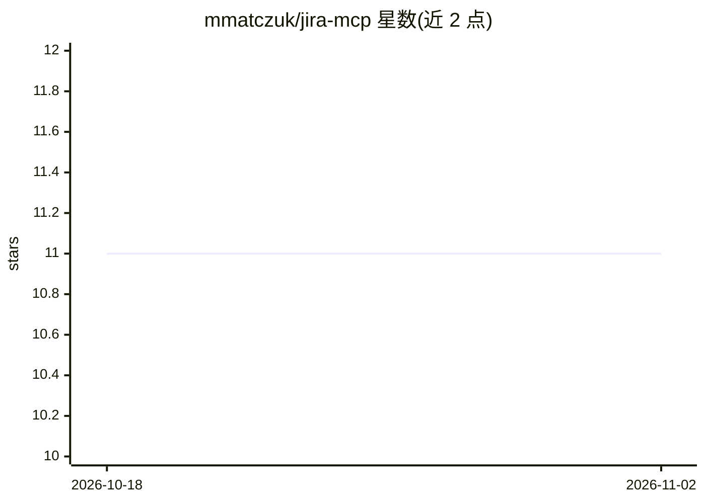

# mmatczuk/jira-mcp

⭐ 11 · Go · MIT · 推送 2026-10-13 · [GitHub](https://github.com/mmatczuk/jira-mcp) · 个人维护

**给 AI agent 用的本地 Jira MCP 服务器，仅 4 个工具**

以 Go 单二进制实现的本地 MCP 服务器，通过 stdio 让 AI agent 操作 Jira Cloud（API token 认证）。仅暴露 jira_read/jira_write/jira_schema/jira_user_search 四个组合式工具，以减少上下文占用与误调用。写入默认接受 Markdown 并转换为 ADF，内置必填字段校验、问题类型校验、dry_run 预览与 Confluence 页面链接识别。README 将其与 mcp-atlassian、acli 做功能范围对比。安装途径含 Homebrew、Docker 与发布页二进制。

## 筛选速览

| 维度 | 判定 | 备注 |
|---|---|---|
| AI 角色 | `ai-ecosystem` | LLM/agent 周边工具 |
| 许可风险 | `permissive` | MIT |
| 部署形态 | `desktop` | 安装包/桌面程序 |
| 模型依赖 | — | README 未给出锁定关系 |
| 硬件要求 | — | 无带数字的原话,不猜 |
| 安装摩擦 | `low` | 无编译、无系统依赖或容器化 |
| 成熟度 | — | 结构信号不足 |

## 能力要点

- 4 个工具覆盖读取/写入/schema 发现/用户查找
- Markdown 写入自动转换 ADF，wiki-markup 令牌被检测拒绝
- 创建前校验项目必填字段与问题类型，支持 dry_run 预览
- 单 Go 二进制，零运行时依赖，凭据保留在本机 stdio 进程内

## 适用场景

- 让 Claude Code 等 MCP 客户端直接读写我的 Jira 工单
- 用受限的结构化工具替代给 AI 开 shell 权限操作 Jira
- 以只读模式让 agent 查询项目与工单

## 场景标签

 · 领域:开发工具/Jira 集成

## 证据(README 行号)

> L3: Give your AI agent full Jira access with just 4 tools.
> L18: **Your credentials stay on your machine.** jira-mcp runs as a local process over stdio — no server, no proxy, nothi
> L145: Use the same binary and env vars. The server speaks standard MCP over stdio.

## 星数曲线

2026-10-18 11 → 2026-11-02 11（+0）

---
*卡片 v1 · prompt 1.4 · 生成 2026-11-02 · 置信度 high · 依据 README sha `77df38e25650` · [字段定义](../../DATASET.md)*
