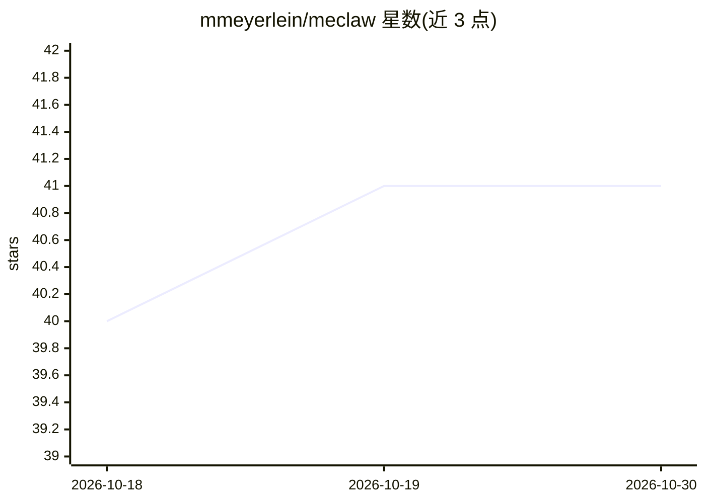

# mmeyerlein/meclaw

⭐ 41 · Rust · Apache-2.0 · 推送 2026-10-29 · [GitHub](https://github.com/mmeyerlein/meclaw) · [官网](https://meclaw.ai) · 个人维护

**Rust 编写的多智能体系统构建框架，单二进制交付**

开源 Rust 框架，用于组合复杂 agentic 系统：单一二进制内提供本体约束（ontology-grounded）、可审计的运行方式，定位为让 agent 构建 agent 的基底，可用来搭建自定义 harness 或个人 agentic OS。参考实现 meclaw-os 是构建于其上的完整 agentic OS。提供语音 cell（自有 wire 协议）、带显示界面的 web cell 与保管密钥的 vault，各 cell 运行于内核沙箱。支持任意 OpenAI 兼容端点与 MCP 服务器，快速启动脚本可拉起默认助手。

## 筛选速览

| 维度 | 判定 | 备注 |
|---|---|---|
| AI 角色 | `ai-ecosystem` | LLM/agent 周边工具 |
| 许可风险 | `permissive` | Apache-2.0 |
| 部署形态 | `None` |  |
| 模型依赖 | locked-api |  |
| 硬件要求 | — | 无带数字的原话,不猜 |
| 安装摩擦 | `low` | 无编译、无系统依赖或容器化 |
| 成熟度 | — | 结构信号不足 |

## 能力要点

- 单二进制 Rust 框架，组合复杂 agentic 系统
- 本体约束与可审计机制
- 语音 cell、web cell、密钥 vault，各 cell 位于内核沙箱
- 支持任意 OpenAI 兼容端点与 MCP 服务器

## 适用场景

- 快速试验新的 agent harness 结构
- 搭建自己的 agentic OS
- 构建需要沙箱隔离与密钥保管的多智能体系统

## 场景标签

`Agent 框架` `多智能体` · 领域:Agent 开发

## 证据(README 行号)

> L10: meclaw is an open-source Rust framework for composing complex agentic systems, not just agents: fast, secure, ontol
> L16: meclaw talks to any OpenAI-compatible endpoint and to MCP servers.

## 星数曲线

2026-10-18 40 → 2026-10-30 41（+1）

---
*卡片 v1 · prompt 1.4 · 生成 2026-10-25 · 置信度 high · 依据 README sha `f9dec5b899d4` · [字段定义](../../DATASET.md)*
