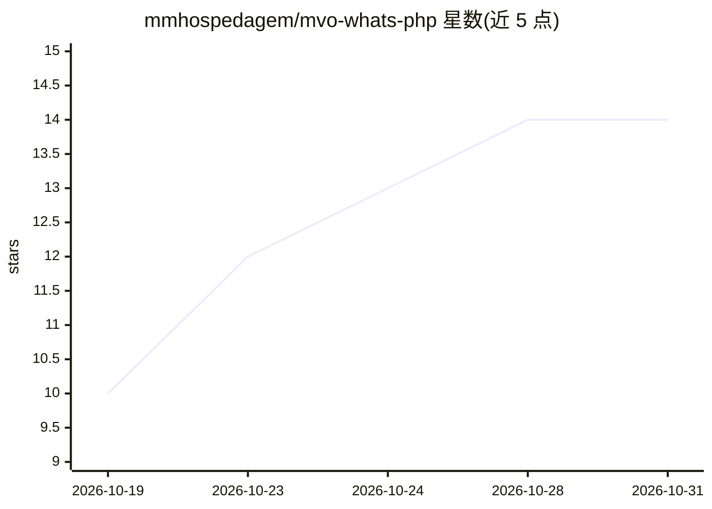

# mmhospedagem/mvo-whats-php

⭐ 14 · PHP · NOASSERTION · 推送 2026-10-27 · [GitHub](https://github.com/mmhospedagem/mvo-whats-php) · [官网](https://mmhospedagem.github.io/mvo-whats-php/) · 组织维护

**PHP 原生 WhatsApp 协议库：QR 连接、多会话、消息与媒体**

纯 PHP 实现的 WhatsApp 协议 SDK，无需 Node.js 或中间 API：支持 QR 码配对与轮换、持久会话与断线恢复、文本/媒体/位置/联系人/反应/投票/互动消息、群组与社区管理、Business 目录、SQLite 及可配置后端存储、history.sink 增量外置历史。单次安装可运行多个隔离会话（建议每会话一个 worker，带锁防并发）。另提供 MCP 与 llms-full.txt 供 LLM/agent 集成。需 PHP 8.2+，媒体与通话部分功能依赖可选的 FFmpeg。非 Meta 官方产品，功能可用性取决于账户与服务器。

## 筛选速览

| 维度 | 判定 | 备注 |
|---|---|---|
| AI 角色 | `ai-enhanced` | 去掉 AI 部分产品仍成立 |
| 许可风险 | `none` | NOASSERTION |
| 部署形态 | `None` |  |
| 模型依赖 | — | README 未给出锁定关系 |
| 硬件要求 | — | 无带数字的原话,不猜 |
| 安装摩擦 | `medium` | 含编译或系统依赖之一 |
| 成熟度 | — | 结构信号不足 |

## 能力要点

- 纯 PHP 实现协议传输与加密，无需 Node.js 或中间 API
- 单安装多隔离会话，会话级锁防并发连接
- 消息、媒体、群组、Business、状态与频道等资源覆盖
- 提供 MCP 集成与 llms-full.txt 上下文供 LLM/agent 使用

## 适用场景

- 在 PHP 应用中收发 WhatsApp 消息并处理事件
- 为多个 WhatsApp 账户维护隔离的持久会话
- 让 LLM/agent 通过 MCP 接入 WhatsApp 收发消息

## 场景标签

 · 领域:消息通信/PHP SDK

## 证据(README 行号)

> L22: Use uma instalação da biblioteca para atender várias contas, cada uma com seu próprio identificador, credenciais e 
> L86: |Extensões|Formulários, agendamentos, plugins, MCP e chamadas opcionais|Formulários · Agendamentos · MCP · VoIP|
> L109: - Integrar LLMs e agentes com MCP, ou fornecer llms-full.txt como contexto completo ao modelo.

## 星数曲线

2026-10-19 10 → 2026-10-31 14（+4）

---
*卡片 v1 · prompt 1.4 · 生成 2026-10-31 · 置信度 high · 依据 README sha `3247bbb29730` · [字段定义](../../DATASET.md)*
