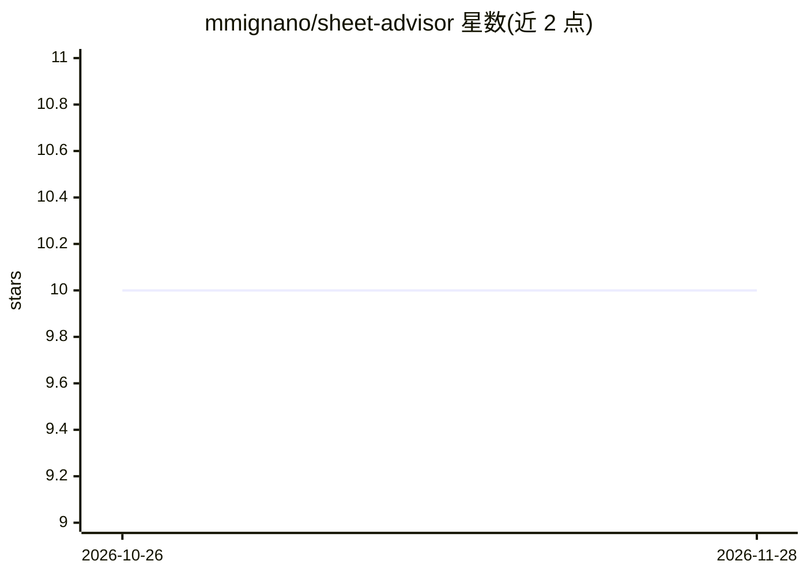

# mmignano/sheet-advisor

⭐ 10 · JavaScript · MIT · 推送 2026-05-01 · [GitHub](https://github.com/mmignano/sheet-advisor) · 个人维护

**基于 Google Sheets 与 Claude 的投资组合每日监控工具**

运行在 Google Sheets + Apps Script 上的投资组合监控系统：用户先在 claude.ai 生成策略 markdown（持仓、论点、目标权重、再平衡规则），通过 clasp 部署到表格；每日收盘后拉取价格、计算组合状态并调用 Claude 分析，发送每日邮件与每周摘要，输出评估等级与再平衡建议。仅做分析与提醒，不代下单。AI 分析可选关闭，可零 API 成本以纯机械模式运行。

## 筛选速览

| 维度 | 判定 | 备注 |
|---|---|---|
| AI 角色 | `ai-native` | 本体是模型或模型工具 |
| 许可风险 | `permissive` | MIT |
| 部署形态 | `library` | 以包/库形式分发 |
| 模型依赖 | locked-api |  |
| 硬件要求 | — | 无带数字的原话,不猜 |
| 安装摩擦 | `low` | 无编译、无系统依赖或容器化 |
| 成熟度 | — | 结构信号不足 |

## 能力要点

- 策略 markdown 定义持仓论点与评估规则，Claude 按论点解读波动
- 每日邮件含 AI 评估（all clear/flag/action needed）与再平衡建议
- 价格源优先 GOOGLEFINANCE()，缺失时回退 Yahoo Finance 非官方 API
- 可关闭 AI（AI Enabled: false）以零 API 成本机械模式运行

## 适用场景

- 按自己的投资论点建立策略并每日自动监控
- 持仓偏离目标权重时收到再平衡提醒
- 跟踪每笔持仓的论点是否失效

## 场景标签

`金融量化` · 领域:学习与行业

## 证据(README 行号)

> L5: You bring a thesis — a conviction about where the world is going, a sector you believe in, a trend you want to bet o
> L22: Every day at market close, Sheet Advisor fetches prices, calculates your portfolio state, and calls Claude to asses
> L79: AI analysis is **optional**. Set `AI Enabled: false` in your Settings tab to run in mechanical-only mode at zero AP

## 星数曲线

2026-10-26 10 → 2026-11-28 10（+0）

---
*卡片 v1 · prompt 1.4 · 生成 2026-11-19 · 置信度 high · 依据 README sha `276e858acd0c` · [字段定义](../../DATASET.md)*
