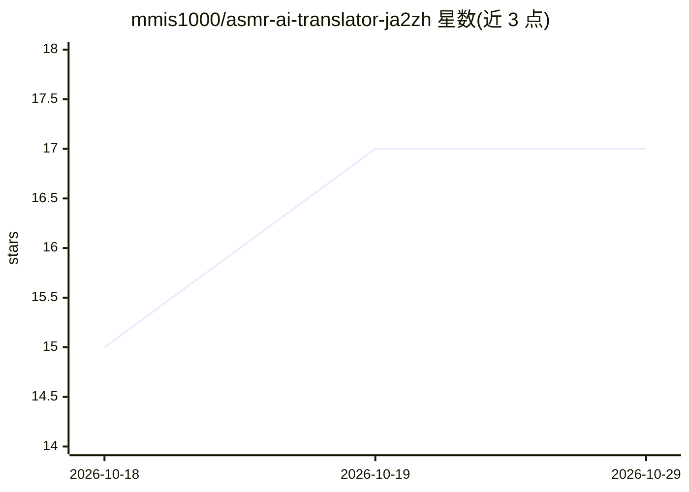

# mmis1000/asmr-ai-translator-ja2zh

⭐ 17 · TypeScript · 推送 2026-04-13 · [GitHub](https://github.com/mmis1000/asmr-ai-translator-ja2zh) · 个人维护 · 中文 README

**将日语 ASMR 音频转录并翻译为中文的 CLI 流水线**

面向个人用户的 TypeScript CLI 流水线，串联 GPU 加速 ASR（Whisper/SenseVoice/MMS/Qwen/Gemma）与 GGUF LLM（经 llama-server 运行），把日语 ASMR 音频转录并翻译为繁体或简体中文，输出 JSON 与 SRT 字幕。可选抓取 DLSite 元数据生成逐作品术语表注入翻译；含幻觉过滤、低信噪比片段的二次修复（可选用 Demucs 人声分轨）。模型为 Qwen3.5-9B LoRA 微调的 GGUF，提供 q4_k_m 到 bf16 四档量化。运行需 Node.js 20+、Python 3.12+uv、llama-server，ASR 环境面向 AMD ROCm（Windows）搭建。

## 筛选速览

| 维度 | 判定 | 备注 |
|---|---|---|
| AI 角色 | `ai-native` | 本体是模型或模型工具 |
| 许可风险 | `none` | — |
| 部署形态 | `desktop` | 安装包/桌面程序 |
| 模型依赖 | local-ok | 支持本地模型 |
| 硬件要求 | — | 无带数字的原话,不猜 |
| 安装摩擦 | `low` | 无编译、无系统依赖或容器化 |
| 成熟度 | — | 结构信号不足 |

## 能力要点

- ASR（Whisper/SenseVoice/MMS/Qwen/Gemma）+ GGUF LLM 翻译的完整流水线
- DLSite/yt-dlp 元数据抓取生成逐作品术语表注入翻译
- 转写清洗与外科式修复：过滤幻觉、低 SNR 片段与重复循环
- 提供繁体/简体两种独立训练的翻译模型（q4_k_m–bf16 四档量化）

## 适用场景

- 把日语 ASMR 音声作品翻译成中文字幕
- 从 yt-dlp 支持的 URL 下载音轨并生成翻译字幕
- 利用 DLSite 元数据提升角色名与术语的翻译一致性

## 场景标签

`语音识别` · 领域:感知与多模态

## 证据(README 行号)

> L5: A CLI pipeline for transcribing and translating Japanese ASMR audio to Traditional or Simplified Chinese. It chains 
> L216: 1. **Optional yt-dlp** — if `--ytdlp` is set, download audio (or skip download when `*.info.json` already exists i
> L223: 8. **Output** — JSON transcription, JSON translation, SRT subtitles per track

## 星数曲线

2026-10-18 15 → 2026-10-29 17（+2）

---
*卡片 v1 · prompt 1.4 · 生成 2026-10-29 · 置信度 high · 依据 README sha `2153aed7ce89` · [字段定义](../../DATASET.md)*
