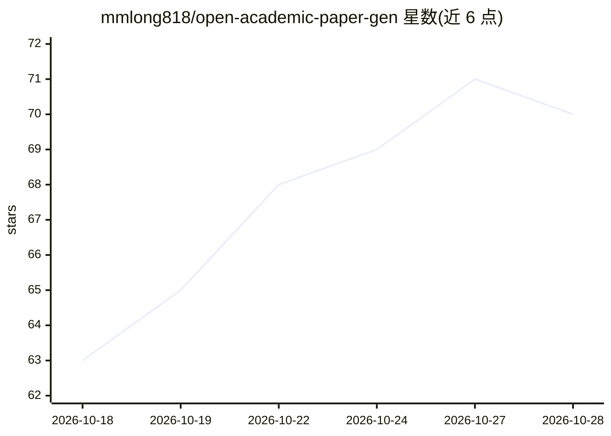

# mmlong818/open-academic-paper-gen

⭐ 70 · Python · AGPL-3.0 · 推送 2026-10-07 · [GitHub](https://github.com/mmlong818/open-academic-paper-gen) · 个人维护 · 中文 README

**从研究题目生成引文可核验的学术论文草稿的多 agent 流水线**

基于 LangGraph 九阶段状态机的多 agent 学术写作流水线：输入研究题目后，经 OpenAlex/Crossref/Semantic Scholar/arXiv 多源检索开放获取文献，LLM 筛选与引文链扩展构建文献池，再分节撰写带 [cite:KEY] 标记的草稿。每条引文经三重核验（标记可解析、DOI/元数据与真实记录匹配、被引论文确实支持该论断），未通过的内容被标记、受限修订或留待人工审阅，每阶段后设人工审批门。输出 Markdown/LaTeX/RIS/BibTeX。需 Python 3.12+、Node.js 20+、PostgreSQL 与 OpenAI API key；Docker 仅提供数据库，应用本体在本机运行。面向需要可核验文献起步草稿的研究者，明确声明产出是起点而非完成稿。

## 筛选速览

| 维度 | 判定 | 备注 |
|---|---|---|
| AI 角色 | `ai-native` | 本体是模型或模型工具 |
| 许可风险 | `viral` | AGPL-3.0 |
| 部署形态 | `self-host` | docker 或自建部署 |
| 模型依赖 | — | README 未给出锁定关系 |
| 硬件要求 | — | 无带数字的原话,不猜 |
| 安装摩擦 | `low` | 无编译、无系统依赖或容器化 |
| 成熟度 | — | 结构信号不足 |

## 能力要点

- 四源检索（OpenAlex/Crossref/Semantic Scholar/arXiv）并抓取开放获取 PDF 全文
- 每条引文三重核验：键解析、DOI/元数据匹配、论断支持度检查（可给出 PDF 页码）
- 九阶段流水线均支持人工审批门（key_gates）或全自动（full_auto）模式
- 模拟三审稿人评审与机翻腔文风检查，导出 GB/T 7714、APA 7 等多种引用格式

## 适用场景

- 从研究题目生成每条引文都指向真实文献的论文初稿
- 生成证据表（每篇论文一行：任务/方法/数据/指标/发现/局限）辅助文献综述
- 对草稿引文做幻觉检测与论断-来源匹配核验
- 做新颖性诊断：评估选题角度并指出最接近的已有工作

## 场景标签

`科研工具` `AI 写作` · 领域:内容生成

## 证据(README 行号)

> L14: > A multi-agent pipeline that turns a research topic into a draft academic paper grounded in real literature, with 
> L22: The output is a draft with a verifiable reference list. It is a starting point for a researcher, not a finished pap

## 星数曲线

2026-10-18 63 → 2026-10-28 70（+7）

---
*卡片 v1 · prompt 1.4 · 生成 2026-10-24 · 置信度 high · 依据 README sha `cfca203a796a` · [字段定义](../../DATASET.md)*
