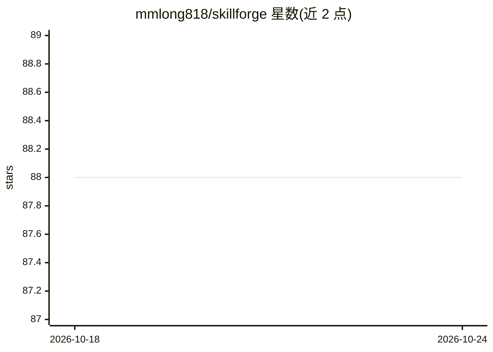

# mmlong818/skillforge

⭐ 88 · TypeScript · NOASSERTION · 推送 2026-07-16 · [GitHub](https://github.com/mmlong818/skillforge) · 个人维护 · 中文 README

**用 AI 生成符合规范 Agent Skills 的 Web 应用**

SkillForge 是一个 Web 应用，内置 4 步生成引擎，用于从名称和描述自动生成符合 Anthropic Agent Skills 规范的 SKILL.md 及配套资源文件，并打包为 ZIP 下载；另提供 3 步流程对已有 Skill 进行诊断与重写。支持 Claude CLI、Anthropic API、OpenAI 兼容 API（含 DeepSeek、Ollama 等）三种 LLM 后端。技术栈为 React 19 + Express/tRPC + MySQL/TiDB，需 Node.js 22+ 环境并通过 git clone 源码部署，数据库需手动执行 Drizzle 迁移脚本。

## 筛选速览

| 维度 | 判定 | 备注 |
|---|---|---|
| AI 角色 | `ai-ecosystem` | LLM/agent 周边工具 |
| 许可风险 | `none` | NOASSERTION |
| 部署形态 | `None` |  |
| 模型依赖 | local-ok | 支持本地模型 |
| 硬件要求 | — | 无带数字的原话,不猜 |
| 安装摩擦 | `low` | 无编译、无系统依赖或容器化 |
| 成熟度 | — | 结构信号不足 |

## 能力要点

- 4 步流程生成 SKILL.md 与资源文件，对齐 Anthropic 官方规范
- 3 步流程诊断并重写已有 Skill
- 三种 LLM 后端：Claude CLI / Anthropic API / OpenAI 兼容 API
- %%SKILL_BEGIN%% 标记精确提取，ZIP 一键打包下载

## 适用场景

- 为 Claude 类 agent 生成规范格式的 SKILL.md 技能文件
- 诊断并重写不符合最佳实践的现有 Skill
- 批量产出含 scripts/references 的完整 Skill 包

## 场景标签

`提示工程` · 领域:Agent 开发

## 证据(README 行号)

> L12: SkillForge 是一个完整的 Web 应用，内置经过实战验证的 **4 步 Agent Skills 生成引擎**，严格对齐 Anthropic 官方 Agent Skills 规范。
> L35: |Step 2|SKILL.md 生成|生成符合官方规范的 SKILL.md（30-150 行，≤200 行上限）|
> L152: SkillForge 生成的每个 Skill 严格对齐 Anthropic 官方规范：

## 星数曲线

2026-10-18 88 → 2026-10-24 88（+0）

---
*卡片 v1 · prompt 1.4 · 生成 2026-10-23 · 置信度 high · 依据 README sha `d1c40ed5a6b8` · [字段定义](../../DATASET.md)*
