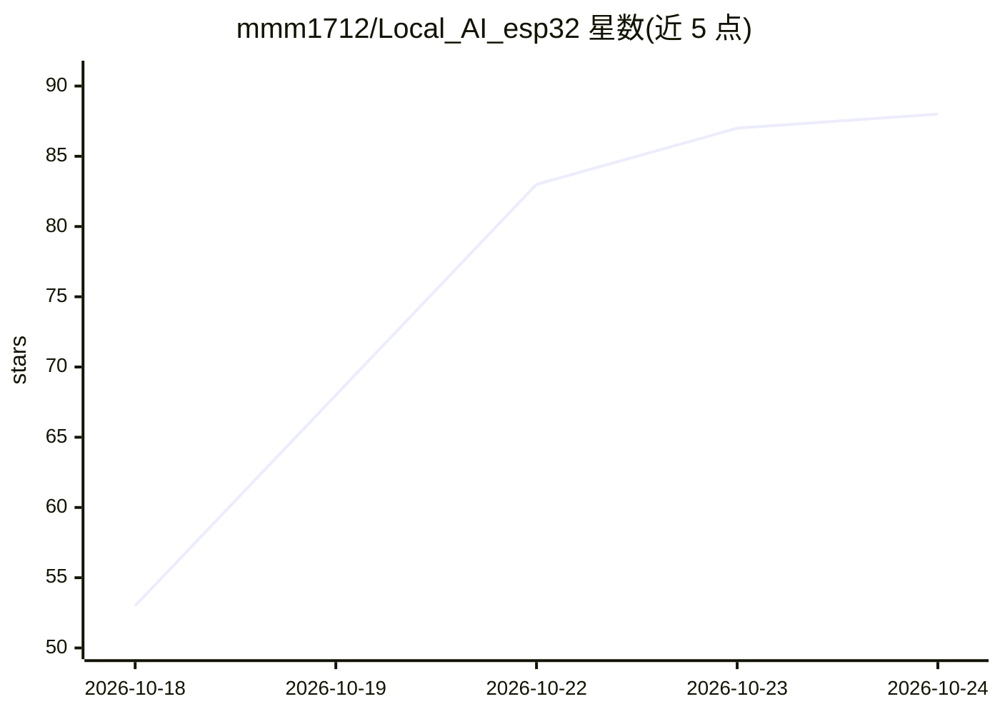

# mmm1712/Local_AI_esp32

⭐ 88 · C · MIT · 推送 2026-10-23 · [GitHub](https://github.com/mmm1712/Local_AI_esp32) · [官网](https://youtu.be/LgCNVUndTH8) · 个人维护

**在 ESP32-S3 上离线运行的从零训练小型语言模型及手持设备**

从零训练的 30M 参数 decoder-only Transformer，部署在 ESP32-S3 上离线生成文本。支持两种硬件：XIAO ESP32-S3（8MB Flash/8MB PSRAM，配触摸屏键盘与 microSD）和 ESP32-S3 DevKit（32MB octal Flash/16MB PSRAM，USB 聊天）。作者自述为个人实验，能力有限：只能产生简短问候与基础对话回复，答案可能错误、重复或无关，基础算术不可靠。上下文 64 token，每次最多生成 24 token，实测速度约 0.74-1.41 token/s。附带训练代码与可选的 Gemini/Ollama 网络固件。

## 筛选速览

| 维度 | 判定 | 备注 |
|---|---|---|
| AI 角色 | `ai-native` | 本体是模型或模型工具 |
| 许可风险 | `permissive` | MIT |
| 部署形态 | `None` |  |
| 模型依赖 | local-ok | 支持本地模型 |
| 硬件要求 | — | 无带数字的原话,不猜 |
| 安装摩擦 | `low` | 无编译、无系统依赖或容器化 |
| 成熟度 | `idea` | |

## 能力要点

- 30,460,864 独立训练参数的 decoder-only Transformer（12 层，hidden 448）
- 无 API key、无训练需求，模型权重与 tokenizer 从 Releases 下载
- 64 token 上下文，每次最多生成 24 token，XIAO 实测约 0.742 token/s
- 附带原始训练代码与设置（Base V2，约 3 亿 token 位置训练）

## 适用场景

- 在微控制器上离线运行语言模型做硬件实验
- 验证小参数 Transformer 在 ESP32 级内存布局（Flash/PSRAM/microSD）下的部署
- 作为从零训练到嵌入式推理的完整参考流程

## 场景标签

`推理引擎` · 领域:训练与推理

## 证据(README 行号)

> L5: A language model trained from scratch and running offline on an ESP32-S3. Use a touchscreen keyboard on XIAO or chat
> L39: |Architecture|Decoder-only Transformer; 12 layers; hidden size 448|

## 星数曲线

2026-10-18 53 → 2026-10-24 88（+35）

---
*卡片 v1 · prompt 1.4 · 生成 2026-10-23 · 置信度 high · 依据 README sha `05cd51c0a37f` · [字段定义](../../DATASET.md)*
