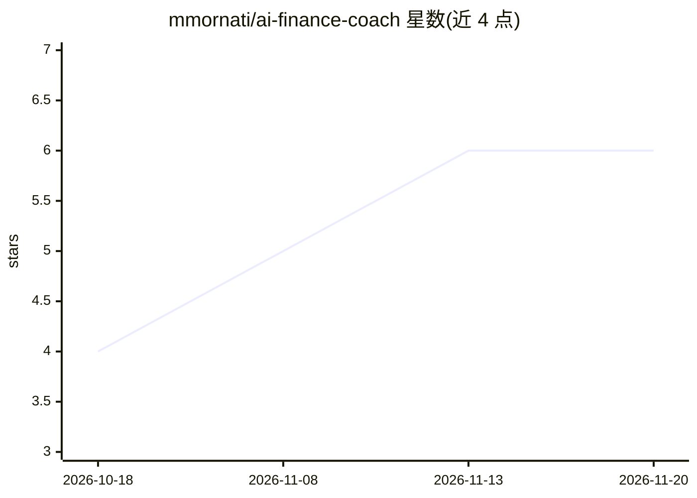

# mmornati/ai-finance-coach

⭐ 6 · Python · MIT · 推送 2026-11-17 · [GitHub](https://github.com/mmornati/ai-finance-coach) · [官网](https://mmornati.github.io/ai-finance-coach/) · 个人维护

**自托管个人理财教练：PSD2 银行同步与本地分析，LLM 不见原始数据**

面向单一家庭的私有理财工具：通过 Enable Banking 的 PSD2 接口同步法/意银行交易（也支持 CSV/OFX/CAMT 导入），用规则、用户笔记与最近邻分类，仅剩余长尾交给语言模型标记；订阅、贷款、预算、现金流预测等数字全部由本地代码计算，模型只产出解释性文字且仅接收脱敏结果。数据存于 SQLCipher 加密数据库，Web 应用仅监听本机。支持 Claude Code、Anthropic API 或本地 Ollama 作为 coach 后端。仅面向法国和意大利家庭，未做第三方审计。

## 筛选速览

| 维度 | 判定 | 备注 |
|---|---|---|
| AI 角色 | `ai-enhanced` | 去掉 AI 部分产品仍成立 |
| 许可风险 | `permissive` | MIT |
| 部署形态 | `self-host` | docker 或自建部署 |
| 模型依赖 | local-ok | 支持本地模型 |
| 硬件要求 | — | 无带数字的原话,不猜 |
| 安装摩擦 | `low` | 无编译、无系统依赖或容器化 |
| 成熟度 | `idea` | |

## 能力要点

- 银行同步、去重、周期支付检测、预测与预算均为纯代码，模型不在数据路径上
- SQLCipher 加密数据库 + macOS Keychain/0600 密钥文件存储
- privacy local_only 模式可全本地 Ollama 运行，仅银行同步走网络
- 13 个 coach 技能（月度回顾、解释峰值、what-if 等）与财务 MCP 只读工具

## 适用场景

- 自动同步 PSD2 银行账户并做本地收支分类与预算
- 回答家庭开支问题（如"九月为什么贵"）且数字可核验
- 管理订阅合同、取消信模板与贷款摊销估算
- 给家庭成员按成人/儿童设置分级访问权限

## 场景标签

 · 领域:个人理财/隐私工具

## 证据(README 行号)

> L3: A private, self-hosted coach for your household's money. It pulls your bank transactions through the EU's open-banki
> L19: * **No model in the data path.** Syncing, deduplication, recurring-payment detection, forecasts and budgets are pla
> L42: |**Coach**|"Ask the coach" in the web app and CLI, weekly and monthly digests, 13 skills (monthly review, explain a

## 星数曲线

2026-10-18 4 → 2026-11-20 6（+2）

---
*卡片 v1 · prompt 1.4 · 生成 2026-11-20 · 置信度 mid · 依据 README sha `60bed5dca9ff` · [字段定义](../../DATASET.md)*
