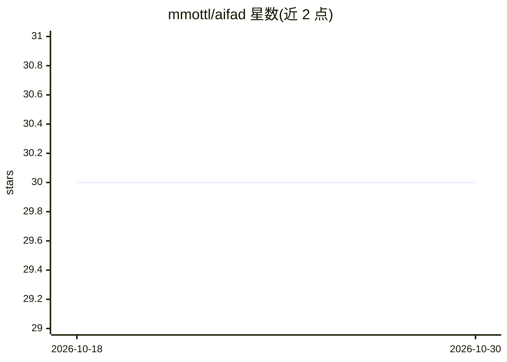

# mmottl/aifad

⭐ 30 · OCaml · NOASSERTION · 推送 2026-08-11 · [GitHub](https://github.com/mmottl/aifad) · 个人维护

**OCaml 编写的决策树学习工具，支持代数数据类型**

AIFAD 是用 OCaml 实现的命令行应用，将决策树学习扩展到代数数据类型：支持多值属性、多目标属性、结构化输入与输出、递归数据以及用 option 类型编码缺失值。用户以 .ads 文件声明类型规格、.add 文件提供训练数据，也可直接读取 C4.5 格式数据（.names/.data）；通过 -learn 等命令行参数训练模型，模型以 OCaml 函数形式输出，可存为机器可读文件供后续应用。限制：不支持数值属性（C4.5 连续属性被忽略）、无后剪枝、不能学习递归函数。

## 筛选速览

| 维度 | 判定 | 备注 |
|---|---|---|
| AI 角色 | `ai-native` | 本体是模型或模型工具 |
| 许可风险 | `none` | NOASSERTION |
| 部署形态 | `None` |  |
| 模型依赖 | — | README 未给出锁定关系 |
| 硬件要求 | — | 无带数字的原话,不猜 |
| 安装摩擦 | `low` | 无编译、无系统依赖或容器化 |
| 成熟度 | — | 结构信号不足 |

## 能力要点

- 支持结构化输入/输出与递归数据类型的决策树归纳
- 多目标属性与以 option 类型编码缺失值
- 可直接读取 C4.5 格式数据（离散部分）
- 模型以 OCaml 函数形式输出，可存为机器可读文件

## 适用场景

- 对含结构化或递归结构的数据学习预测函数
- 复用已有 C4.5 格式离散数据训练决策树
- 以 OCaml 代码形式获得可直接应用的模型

## 场景标签

 · 领域:机器学习/结构化数据归纳

## 证据(README 行号)

> L6: and is an application written in OCaml that improves
> L7: decision tree learning by supporting significantly more complex kinds of data.
> L216: Using AIFAD on the command-line, the learning mode is turned on by the

## 星数曲线

2026-10-18 30 → 2026-10-30 30（+0）

---
*卡片 v1 · prompt 1.4 · 生成 2026-10-26 · 置信度 high · 依据 README sha `4c7246604ed0` · [字段定义](../../DATASET.md)*
