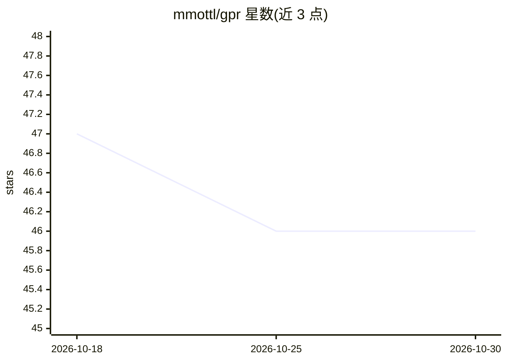

# mmottl/gpr

⭐ 46 · OCaml · NOASSERTION · 推送 2026-06-23 · [GitHub](https://github.com/mmottl/gpr) · 个人维护

**OCaml 高斯过程回归库，含命令行示例应用**

OCaml 语言编写的高斯过程回归（GPR）库，实现多种可扩展近似算法（如 SPGP 稀疏高斯过程），支持任意协方差函数，用于对非线性函数做稀疏高斯过程拟合。随库附带一个示例命令行应用和示例图示。提供在线 API 文档与 GPR 手册作为编程参考；问题反馈与贡献通过 GitHub issue tracker 进行。README 未给出安装命令与系统依赖说明。

## 筛选速览

| 维度 | 判定 | 备注 |
|---|---|---|
| AI 角色 | `ai-native` | 本体是模型或模型工具 |
| 许可风险 | `none` | NOASSERTION |
| 部署形态 | `None` |  |
| 模型依赖 | — | README 未给出锁定关系 |
| 硬件要求 | — | 无带数字的原话,不猜 |
| 安装摩擦 | `low` | 无编译、无系统依赖或容器化 |
| 成熟度 | — | 结构信号不足 |

## 能力要点

- 实现稀疏高斯过程近似算法（如 SPGP）以支持可扩展回归
- 支持任意协方差函数
- 附带命令行示例应用与在线 API 文档

## 适用场景

- 在 OCaml 项目中集成高斯过程回归
- 对非线性函数做稀疏高斯过程拟合并可视化
- 查阅 API 文档学习 GPR 编程接口

## 场景标签

 · 领域:机器学习/回归

## 证据(README 行号)

> L1: # OCaml-GPR - Efficient Gaussian Process Regression in OCaml
> L5: (e.g. _SPGP_) for scalable Gaussian process regression for arbitrary covariance

## 星数曲线

2026-10-18 47 → 2026-10-30 46（-1）

---
*卡片 v1 · prompt 1.4 · 生成 2026-10-25 · 置信度 high · 依据 README sha `8fbc95cb9ad2` · [字段定义](../../DATASET.md)*
