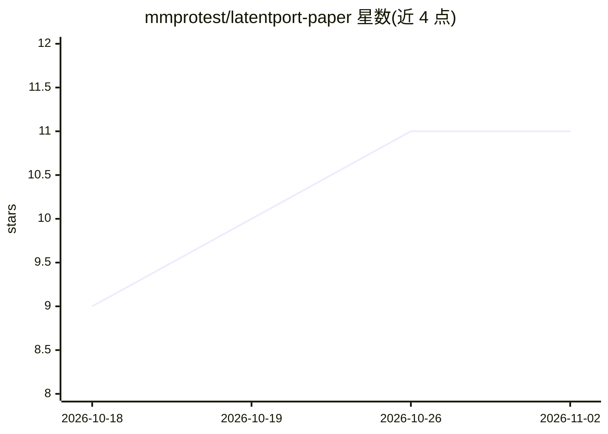

# mmprotest/latentport-paper

⭐ 11 · Python · Apache-2.0 · 推送 2026-09-24 · [GitHub](https://github.com/mmprotest/latentport-paper) · [官网](https://arxiv.org/abs/2609.25053) · 个人维护

**论文仓库：Qwen3.5 4B→9B 跨模型推理状态迁移**

LatentPort 论文的配套代码与证据仓库：研究在 Qwen3.5 4B→9B 同架构兄弟模型对之间，不重放历史前缀（target_prefix_replay_tokens=0）的情况下迁移推理状态，迁移对象除 KV cache 外还包含持久 Gated DeltaNet 循环状态与卷积历史。仓库包含冻结的 E001/E002 证据，可在 Python 3.11 环境下用脚本重算论文的头条统计量、表格与图表；从头重跑原始 GPU 实验需要指定模型检查点与运行环境。论文自述局限：仅单一模型对、单向迁移、近原生门槛未通过、自由生成与下游任务等价性未证明。

## 筛选速览

| 维度 | 判定 | 备注 |
|---|---|---|
| AI 角色 | `ai-knowledge` | 知识聚合/清单类 |
| 许可风险 | `permissive` | Apache-2.0 |
| 部署形态 | `library` | 以包/库形式分发 |
| 模型依赖 | — | README 未给出锁定关系 |
| 硬件要求 | — | 无带数字的原话,不猜 |
| 安装摩擦 | `low` | 无编译、无系统依赖或容器化 |
| 成熟度 | — | 结构信号不足 |

## 能力要点

- 迁移对象含 KV cache、持久 GDN 循环状态与卷积历史
- 接收端处理零个历史 target-prefix token
- 含 E001/E002 冻结证据与验证脚本（verify_results.py 校验密封哈希）
- Apache-2.0 许可（专利范围待所有者决定，见 LICENSE_NOTICE.md）

## 适用场景

- 复现论文的头条统计量、表格与图表
- 审阅 E001/E002 实验协议与冻结证据
- 研究混合架构语言模型的跨模型状态迁移

## 场景标签

`科研工具` · 领域:学习与行业

## 证据(README 行号)

> L14: **Paper:** arXiv:2609.25053 ·
> L83: The repository includes the frozen E001/E002 evidence required to regenerate the published headline aggregate stati

## 星数曲线

2026-10-18 9 → 2026-11-02 11（+2）

---
*卡片 v1 · prompt 1.4 · 生成 2026-11-02 · 置信度 high · 依据 README sha `4e8c036c9694` · [字段定义](../../DATASET.md)*
