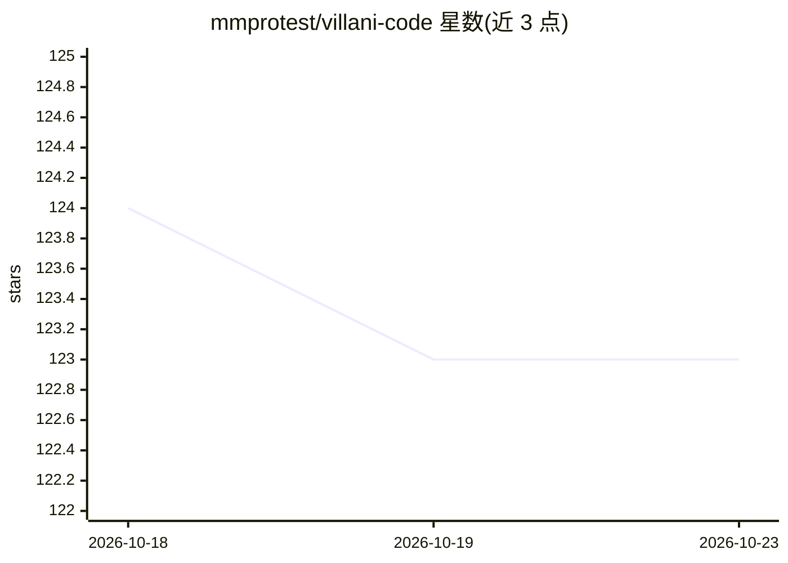

# mmprotest/villani-code

⭐ 123 · Python · 推送 2026-08-08 · [GitHub](https://github.com/mmprotest/villani-code) · 个人维护

**面向小模型的本地优先终端编码代理运行时**

终端优先的编码代理运行时，定位为让较小的开源模型完成真实仓库工作：文件导航、执行命令、制作补丁、通过验证循环与失败恢复持续工作。提供交互式会话、一次性任务与自主模式三种运行方式，通过 --base-url 接入本地推理端点（示例为 127.0.0.1:1234）。README 报告 Terminal-Bench 2.0 上使用 Qwen3.6 27B 取得 44.0%（196/445），为自跑下界结果，未经 Terminal-Bench 团队验证。从源码 pip 安装，另提供 Pi 扩展包。

## 筛选速览

| 维度 | 判定 | 备注 |
|---|---|---|
| AI 角色 | `ai-ecosystem` | LLM/agent 周边工具 |
| 许可风险 | `none` | — |
| 部署形态 | `library` | 以包/库形式分发 |
| 模型依赖 | — | README 未给出锁定关系 |
| 硬件要求 | — | 无带数字的原话,不猜 |
| 安装摩擦 | `low` | 无编译、无系统依赖或容器化 |
| 成熟度 | — | 结构信号不足 |

## 能力要点

- 面向小模型与本地推理的编码代理运行时，含执行循环、失败恢复与任务级内存
- Terminal-Bench 2.0 自跑结果：Qwen3.6 27B 达 44.0%（下界，未官方验证）
- 支持交互式、一次性任务与自主（--villani-mode）三种运行模式
- 提供 Pi 扩展包（/villani 命令）

## 适用场景

- 在本地小模型上做有界 bug 修复与测试引导的补丁
- 在隐私敏感或本地推理环境下执行仓库导航与命令驱动调试
- 作为 Pi 中的扩展运行编码任务

## 场景标签

`编码 Agent` · 领域:编码与开发

## 证据(README 行号)

> L5: Villani Code is a local-first coding-agent runtime designed to make smaller open models do real repository work: nav
> L73: Villani Code is a terminal-first coding agent for:

## 星数曲线

2026-10-18 124 → 2026-10-23 123（-1）

---
*卡片 v1 · prompt 1.4 · 生成 2026-10-23 · 置信度 high · 依据 README sha `42602bec4a35` · [字段定义](../../DATASET.md)*
