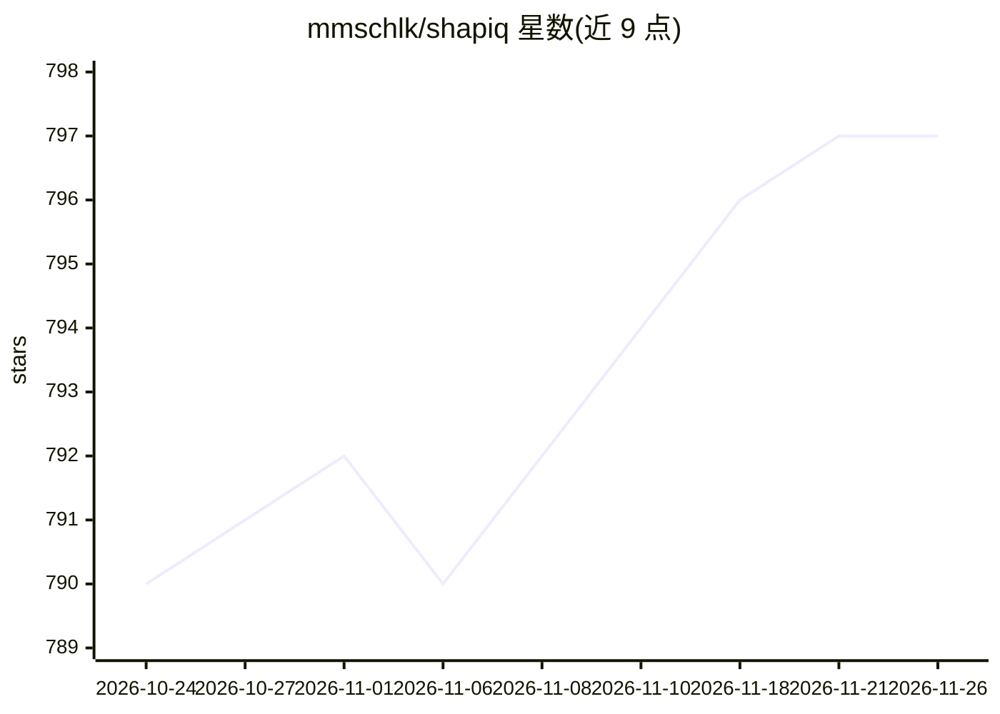

# mmschlk/shapiq

⭐ 797 · Python · MIT · 推送 2026-11-25 · [GitHub](https://github.com/mmschlk/shapiq) · [官网](https://shapiq.readthedocs.io) · 组织维护

**给机器学习研究者与使用者计算 Shapley 交互解释**

shapiq 是一个 Python 包，提供三方面功能：近似任意阶 Shapley 交互值、为博弈论算法提供基准测试、解释模型预测中的特征交互。它扩展 shap 包，将单独的 Shapley 值推广为对特征、数据点或集成模型中弱学习器之间协同效应的量化。通过 shapiq.Explainer 计算交互值，提供网络图等可视化，内置 shapiq_games 与 shapiq_benchmark 模块（需 extras 安装），文档站点提供教程。要求 Python 3.12 及以上，部分可选依赖仅在 3.12–3.14 可用。

## 筛选速览

| 维度 | 判定 | 备注 |
|---|---|---|
| AI 角色 | `ai-native` | 本体是模型或模型工具 |
| 许可风险 | `permissive` | MIT |
| 部署形态 | `library` | 以包/库形式分发 |
| 模型依赖 | — | README 未给出锁定关系 |
| 硬件要求 | — | 无带数字的原话,不猜 |
| 安装摩擦 | `low` | 无编译、无系统依赖或容器化 |
| 成熟度 | — | 结构信号不足 |

## 能力要点

- 近似任意阶 Shapley 交互值，兼容 SHAP 风格的 Shapley 值计算（index='SV'）
- 提供 shapiq.Explainer 与网络图（network_plot）可视化，交互最高可展示二阶
- 内置 shapiq_games 游戏集与 shapiq_benchmark 基准（需 extras）
- 支持解释 TabPFN、CatBoost、SigLIP/CLIP 等模型的预测

## 适用场景

- 解释表格模型预测中哪些特征之间存在交互协同
- 为新的博弈论归因近似算法做基准对比
- 解释图文匹配模型中图像块与文本 token 的交互

## 场景标签

 · 领域:机器学习/可解释性

## 证据(README 行号)

> L18: Shapley Interaction Quantification (`shapiq`) is a Python package for (1) approximating any-order Shapley interacti
> L46: You can explain your model with `shapiq.explainer` and visualize Shapley interactions with `shapiq.plot`.

## 星数曲线

2026-10-24 790 → 2026-11-26 797（+7）

---
*卡片 v1 · prompt 1.4 · 生成 2026-11-24 · 置信度 high · 依据 README sha `fdcc6bacb68c` · [字段定义](../../DATASET.md)*
