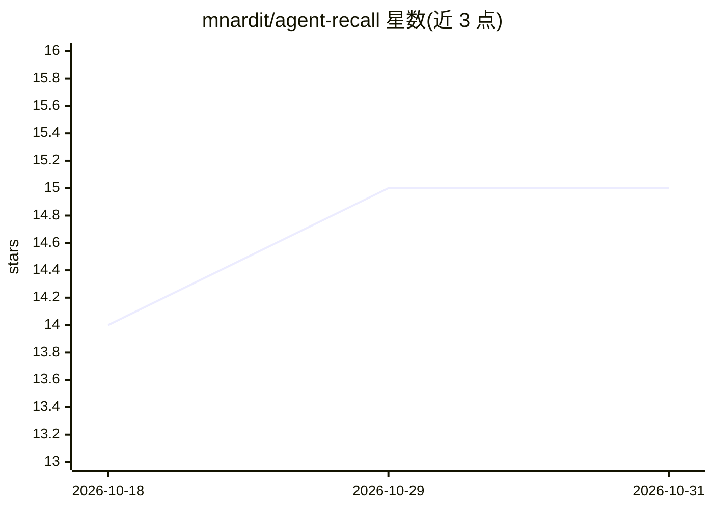

# mnardit/agent-recall

⭐ 15 · Python · MIT · 推送 2026-04-03 · [GitHub](https://github.com/mnardit/agent-recall) · [官网](https://max.nardit.com/agent-recall) · 个人维护

**为 AI 编程 agent 提供跨会话持久记忆的 SQLite 知识图谱**

面向 AI 编程 agent 的持久记忆层：以单个 SQLite 文件存储实体、槽位、观察与关系构成的知识图谱，通过 MCP server 向 agent 暴露 9 个读写工具，并附带让 agent 主动保存事实的行为指令。核心机制包括作用域链继承（同一人在不同项目可有不同角色）、双时态槽位（旧值归档可回溯）、LLM 生成的会话启动简报与自适应缓存。提供 Claude Code/Cursor/Windsurf/Cline 的接入配置，Claude Code 另支持 hooks 自动注入上下文。AI 简报默认走 claude CLI，可切换 Anthropic API 或自带 LLM。从 30+ 并发 agent 的生产系统抽取而来。

## 筛选速览

| 维度 | 判定 | 备注 |
|---|---|---|
| AI 角色 | `ai-ecosystem` | LLM/agent 周边工具 |
| 许可风险 | `permissive` | MIT |
| 部署形态 | `library` | 以包/库形式分发 |
| 模型依赖 | — | README 未给出锁定关系 |
| 硬件要求 | — | 无带数字的原话,不猜 |
| 安装摩擦 | `low` | 无编译、无系统依赖或容器化 |
| 成熟度 | — | 结构信号不足 |

## 能力要点

- 单个 SQLite 文件存储，无需云服务、向量库、Docker 或 Neo4j
- MCP server 暴露 9 个记忆工具并内置主动保存指令
- 作用域链继承与双时态槽位（历史值归档可查）
- LLM 生成会话启动简报，支持自适应缓存失效

## 适用场景

- 让 Claude Code/Cursor/Windsurf 等编程 agent 跨会话记住人名、决策与偏好
- 多 agent 共享一个知识库但按作用域看到不同切片
- 按时间点查询某个事实当时为真（双时态回溯）

## 场景标签

`知识图谱` `Agent 记忆` · 领域:Agent 开发

## 证据(README 行号)

> L8: **Persistent memory for AI coding agents.** Your agent forgets everything between sessions — names, decisions, prefe
> L18: **MCP-native** — designed for MCP-compatible clients. Tested configs included for Claude Code, Cursor, Windsurf, an
> L27: - **MCP-native** — 9 memory tools with proactive-saving instructions. Tested configs for Claude Code, Cursor, Winds

## 星数曲线

2026-10-18 14 → 2026-10-31 15（+1）

---
*卡片 v1 · prompt 1.4 · 生成 2026-10-30 · 置信度 high · 依据 README sha `657bcc216f17` · [字段定义](../../DATASET.md)*
