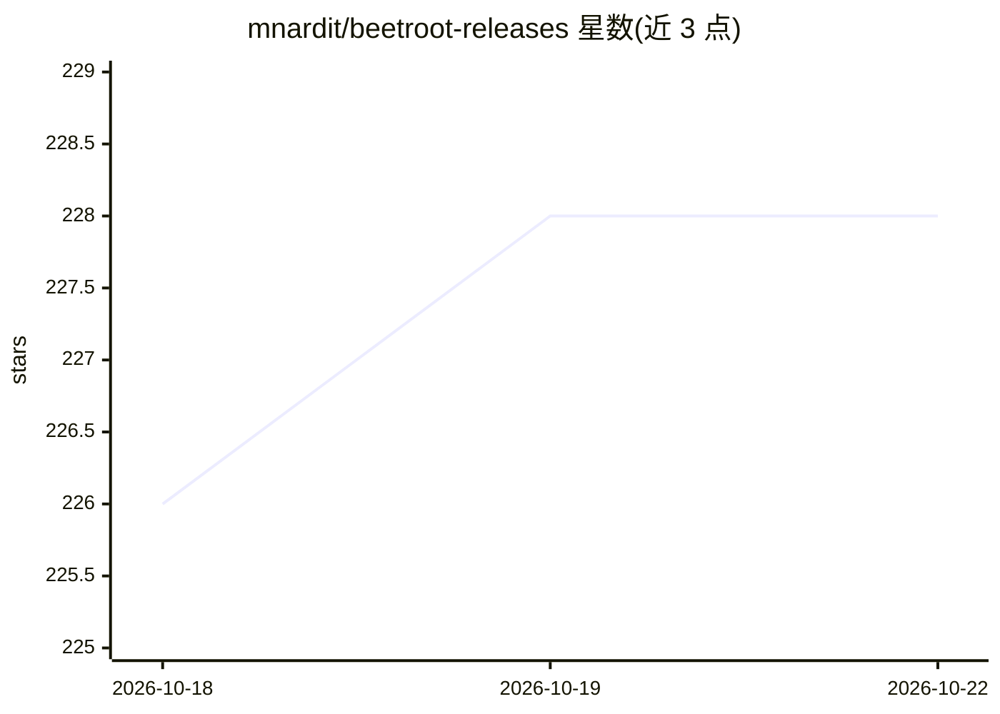

# mnardit/beetroot-releases

⭐ 224 · TypeScript · Apache-2.0 · 推送 2026-09-09 · [GitHub](https://github.com/mnardit/beetroot-releases) · [官网](https://max.nardit.com/beetroot) · 个人维护

**Windows 剪贴板管理器：AI 文本变换、OCR 与模糊搜索**

Tauri/Rust 编写的 Windows 桌面剪贴板管理器：不限量且重启后保留的剪贴板历史、5 阶段模糊与正则搜索、来源应用追踪、本机 OCR（Windows 原生引擎、离线）、图片历史与可搜索备注。AI 部分支持 4 家云厂商（OpenAI/Gemini/Claude/DeepSeek）及本地模型（LM Studio/Ollama），提供 10 个文本与 5 个视觉内置提示词、最多 20 个自定义提示词、BYOK，密钥存于 Windows Credential Manager。通过 GitHub Releases、Microsoft Store 或 winget 安装，Apache 2.0 开源，仅支持 Windows 10/11。

## 筛选速览

| 维度 | 判定 | 备注 |
|---|---|---|
| AI 角色 | `ai-enhanced` | 去掉 AI 部分产品仍成立 |
| 许可风险 | `permissive` | Apache-2.0 |
| 部署形态 | `desktop` | 安装包/桌面程序 |
| 模型依赖 | local-ok | 支持本地模型 |
| 硬件要求 | — | 无带数字的原话,不猜 |
| 安装摩擦 | `low` | 无编译、无系统依赖或容器化 |
| 成熟度 | — | 结构信号不足 |

## 能力要点

- 不限量剪贴板历史，重启持久化，5 阶段模糊+正则搜索
- AI 变换支持 OpenAI/Gemini/Claude/DeepSeek 及本地 LM Studio/Ollama，一键切换
- 本机 OCR（Windows 原生引擎，完全离线）与 AI 视觉（读文字/描述/提取数据）
- 来源应用追踪：每个剪贴条目记录应用图标、名称与窗口标题

## 适用场景

- 在长期剪贴板历史中模糊搜索找回顾内容
- 用 AI 一键修语法、翻译、摘要剪贴板文本或读取图片文字
- 纯本地运行：OCR 与本地 LLM 均不联网上传

## 场景标签

`OCR` · 领域:感知与多模态

## 证据(README 行号)

> L1: Beetroot clipboard manager for Windows
> L8:  AI transforms, OCR, and fuzzy search across your full history — one shortcut away.
> L30: |AI transforms|No|4 cloud providers + local models, 10 text + 5 vision built-in + custom|
> L33: |OCR|No|Native Windows engine, on-device|

## 星数曲线

2026-10-18 226 → 2026-10-22 228（+2）

---
*卡片 v1 · prompt 1.4 · 生成 2026-10-22 · 置信度 high · 依据 README sha `009e1c02c0f8` · [字段定义](../../DATASET.md)*
