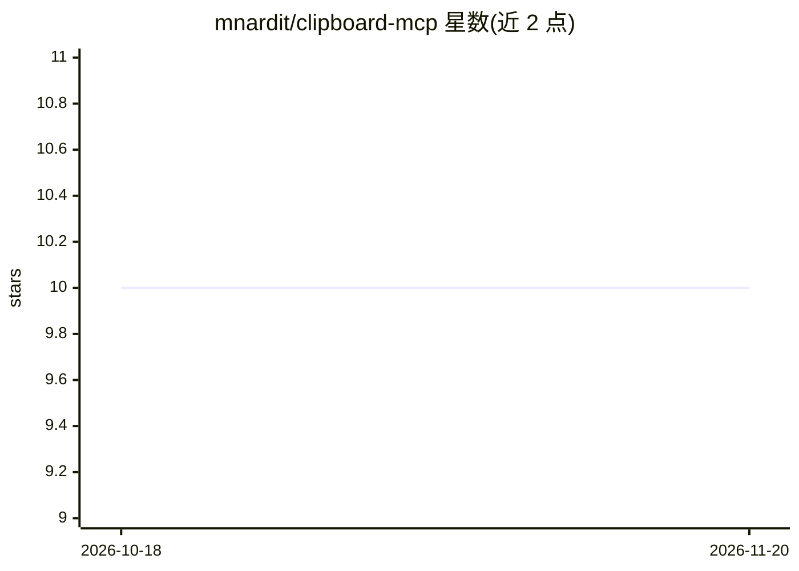

# mnardit/clipboard-mcp

⭐ 10 · Rust · MIT · 推送 2026-03-29 · [GitHub](https://github.com/mnardit/clipboard-mcp) · [官网](https://max.nardit.com/clipboard-mcp) · 个人维护

**让 AI 助手通过 MCP 直接读写系统剪贴板的 Rust 服务器**

跨平台 MCP 服务器，为 AI 助手提供系统剪贴板的读写通道：提供 get/set/clear/watch_clipboard、HTML 读取与格式探测等 6 个工具，支持 watch 模式实时响应复制内容。默认 stdio，可 --http 运行本地 HTTP 服务器供远程 agent 访问（无鉴权）。Rust 单二进制、无 Python/Node 运行时，使用 arboard 原生剪贴板接口。文档含 Claude Desktop/Code 接入配置与安全提示。

## 筛选速览

| 维度 | 判定 | 备注 |
|---|---|---|
| AI 角色 | `ai-ecosystem` | LLM/agent 周边工具 |
| 许可风险 | `permissive` | MIT |
| 部署形态 | `library` | 以包/库形式分发 |
| 模型依赖 | — | README 未给出锁定关系 |
| 硬件要求 | — | 无带数字的原话,不猜 |
| 安装摩擦 | `low` | 无编译、无系统依赖或容器化 |
| 成熟度 | — | 结构信号不足 |

## 能力要点

- 6 个 MCP 工具：读/写/清空剪贴板、watch 变更监听、HTML 读取、格式探测
- watch_clipboard 支持最长 300 秒的实时变更等待
- stdio 与 HTTP 双传输，HTTP 默认仅绑定 localhost
- Rust 单二进制，Windows/macOS/Linux（X11+Wayland）跨平台

## 适用场景

- 复制报错后直接让 Claude 读取并把修复结果写回剪贴板
- 让 agent 监听剪贴板变化并实时总结复制的内容
- 把剪贴板中的 CSV/代码交给 AI 转换或审查后写回

## 场景标签

 · 领域:AI 生态/MCP 工具

## 证据(README 行号)

> L7: Cross-platform Model Context Protocol (MCP) server that gives AI assistants direct read/write access to your system 
> L114: Single binary. Uses arboard (by 1Password) for native clipboard access. Communicates via MCP protocol over stdio (

## 星数曲线

2026-10-18 10 → 2026-11-20 10（+0）

---
*卡片 v1 · prompt 1.4 · 生成 2026-11-19 · 置信度 high · 依据 README sha `ee41b93e347f` · [字段定义](../../DATASET.md)*
