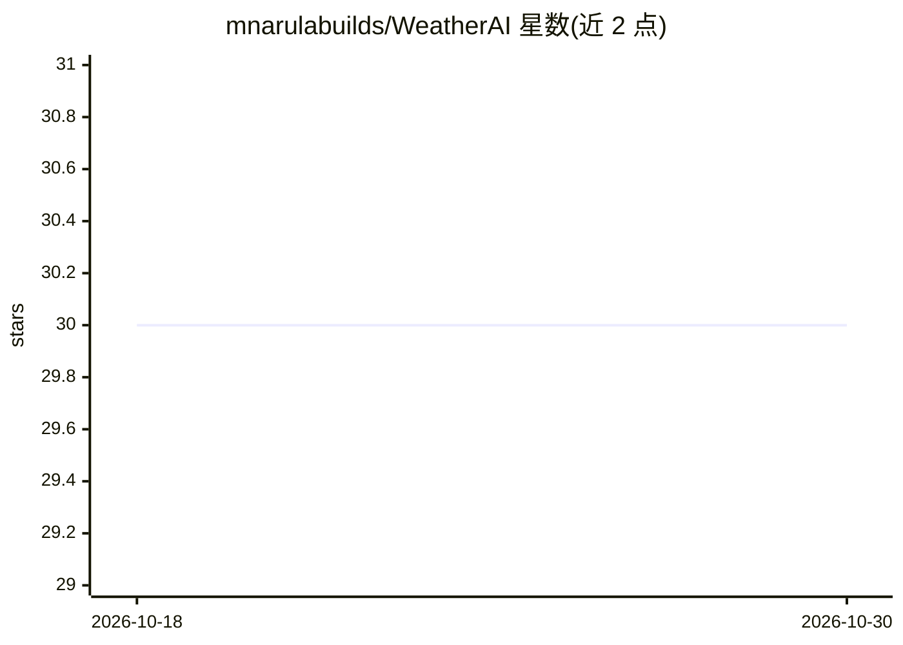

# mnarulabuilds/WeatherAI

⭐ 30 · Python · 推送 2026-09-22 · [GitHub](https://github.com/mnarulabuilds/WeatherAI) · 个人维护

**基于神经网络的天气预报与分类桌面应用（Python）**

Python 编写的天气机器学习应用：从 1997–2015 年的每日历史记录构建数据集，用神经网络做逐特征的年度回归预测，并将天气分类为 Thunderstorm/Rainy/Foggy/Sunny 四类。训练前采用时间切分的留出评估，输出 MAE、R² 与分类准确率。提供 CustomTkinter 桌面控制台与 CLI 两种入口，附 pytest 测试套件并将 weather_ai 包的覆盖率门槛设为 ≥90%。数据行为偏置项加 11 个数值特征加 4 字符类别码。

## 筛选速览

| 维度 | 判定 | 备注 |
|---|---|---|
| AI 角色 | `ai-native` | 本体是模型或模型工具 |
| 许可风险 | `none` | — |
| 部署形态 | `library` | 以包/库形式分发 |
| 模型依赖 | — | README 未给出锁定关系 |
| 硬件要求 | — | 无带数字的原话,不猜 |
| 安装摩擦 | `low` | 无编译、无系统依赖或容器化 |
| 成熟度 | — | 结构信号不足 |

## 能力要点

- 1997–2015 历史数据上的年度特征轨迹预测
- 四类天气分类（Thunderstorm/Rainy/Foggy/Sunny）
- 时间切分留出评估，输出 MAE、R²、分类准确率
- CustomTkinter 桌面控制台与 CLI 双入口，测试覆盖率 ≥90%

## 适用场景

- 在桌面图形界面中训练模型并查看预测与分类结果
- 通过 CLI 运行天气预测引擎
- 学习带评估指标与测试覆盖的机器学习项目结构

## 场景标签

`数据分析` · 领域:效率与自动化

## 证据(README 行号)

> L3: Production-oriented Python application for weather feature prediction and classification using neural networks. The 
> L7: - **Optimized ML pipeline** — vectorized dataset construction, float32 features, scaled regression targets, Adam + e

## 星数曲线

2026-10-18 30 → 2026-10-30 30（+0）

---
*卡片 v1 · prompt 1.4 · 生成 2026-10-26 · 置信度 high · 依据 README sha `7f0c941e1e70` · [字段定义](../../DATASET.md)*
