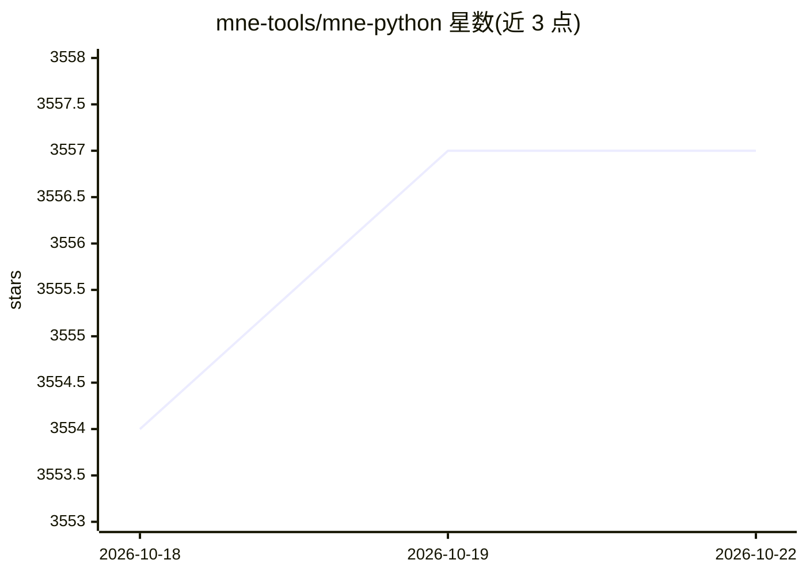

# mne-tools/mne-python

⭐ 3,560 · Python · BSD-3-Clause · 推送 2026-10-22 · [GitHub](https://github.com/mne-tools/mne-python) · [官网](https://mne.tools) · 组织维护

**面向科研者的 MEG/EEG 等神经生理数据分析 Python 库**

开源 Python 包，用于读取、预处理、可视化和分析 MEG、EEG、sEEG、ECoG 等人类神经生理数据，模块覆盖数据输入输出、预处理、源定位、时频分析、连接性分析、机器学习与统计。面向神经科学研究与临床数据分析用户，提供文档、教程与示例，附用户论坛与 GitHub issue 跟踪。最低依赖为 Python ≥ 3.11 及 NumPy/SciPy/Matplotlib 等科学计算库，BSD-3-Clause 许可。

## 筛选速览

| 维度 | 判定 | 备注 |
|---|---|---|
| AI 角色 | `ai-enhanced` | 去掉 AI 部分产品仍成立 |
| 许可风险 | `permissive` | BSD-3-Clause |
| 部署形态 | `library` | 以包/库形式分发 |
| 模型依赖 | — | README 未给出锁定关系 |
| 硬件要求 | — | 无带数字的原话,不猜 |
| 安装摩擦 | `low` | 无编译、无系统依赖或容器化 |
| 成熟度 | — | 结构信号不足 |

## 能力要点

- 支持 MEG/EEG/sEEG/ECoG 等多种神经生理数据的读取与预处理
- 提供源定位、时频分析、连接性分析、机器学习与统计模块
- 提供文档、教程、示例与独立安装器

## 适用场景

- 分析脑电/脑磁图实验数据并做源定位与时频分析
- 对神经生理信号做预处理与统计检验
- 可视化神经影像数据用于科研报告

## 场景标签

`科研工具` · 领域:学习与行业

## 证据(README 行号)

> L7: MNE-Python is an open-source Python package for exploring,
> L11: machine learning, statistics, and more.

## 星数曲线

2026-10-18 3,554 → 2026-10-22 3,557（+3）

---
*卡片 v1 · prompt 1.4 · 生成 2026-10-20 · 置信度 high · 依据 README sha `91537bd65acf` · [字段定义](../../DATASET.md)*
