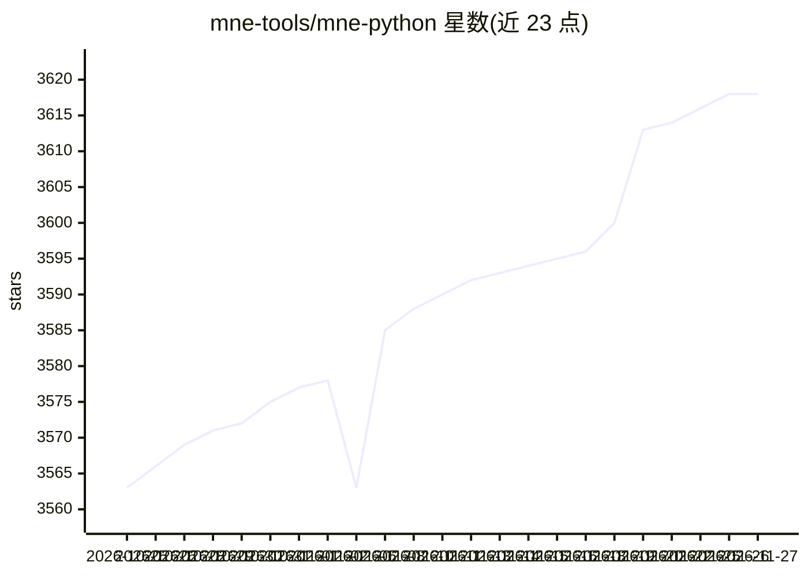

# mne-tools/mne-python

⭐ 3,618 · Python · BSD-3-Clause · 推送 2026-11-25 · [GitHub](https://github.com/mne-tools/mne-python) · [官网](https://mne.tools) · 组织维护

**神经生理数据分析 Python 库：MEG/EEG 等数据的探索与可视化**

开源 Python 包，用于探索、可视化和分析 MEG、EEG、sEEG、ECoG 等人类神经生理数据。模块覆盖数据读写、预处理、可视化、源估计、时频分析、连接性分析、机器学习与统计。安装支持 pip、独立安装包、conda-forge 与源码克隆，最小依赖为 Python≥3.11 及 NumPy、SciPy、Matplotlib 等科学计算库。采用 BSD-3-Clause 许可，通过论坛与 issue tracker 提供支持渠道。

## 筛选速览

| 维度 | 判定 | 备注 |
|---|---|---|
| AI 角色 | `ai-enhanced` | 去掉 AI 部分产品仍成立 |
| 许可风险 | `permissive` | BSD-3-Clause |
| 部署形态 | `library` | 以包/库形式分发 |
| 模型依赖 | — | README 未给出锁定关系 |
| 硬件要求 | — | 无带数字的原话,不猜 |
| 安装摩擦 | `low` | 无编译、无系统依赖或容器化 |
| 成熟度 | — | 结构信号不足 |

## 能力要点

- 支持 MEG、EEG、sEEG、ECoG 等多种神经生理数据的读写与预处理
- 内置源估计、时频分析、连接性分析、机器学习与统计模块
- 提供 pip、conda-forge、独立安装包与源码四种安装途径
- 文档站包含教程、示例、贡献指南与 API 参考

## 适用场景

- 对 MEG/EEG 实验数据进行预处理和时频分析
- 做脑电源定位（source estimation）与连接性分析
- 在教学和科研中可视化神经生理数据
- 在脑数据分析流程中调用其机器学习与统计模块

## 场景标签

`科研工具` · 领域:学习与行业

## 证据(README 行号)

> L7: MNE-Python is an open-source Python package for exploring,
> L10: visualization, source estimation, time-frequency analysis, connectivity analysis,
> L11: machine learning, statistics, and more.

## 星数曲线

2026-10-25 3,563 → 2026-11-27 3,618（+55）

---
*卡片 v1 · prompt 1.4 · 生成 2026-11-24 · 置信度 high · 依据 README sha `253423c79e31` · [字段定义](../../DATASET.md)*
