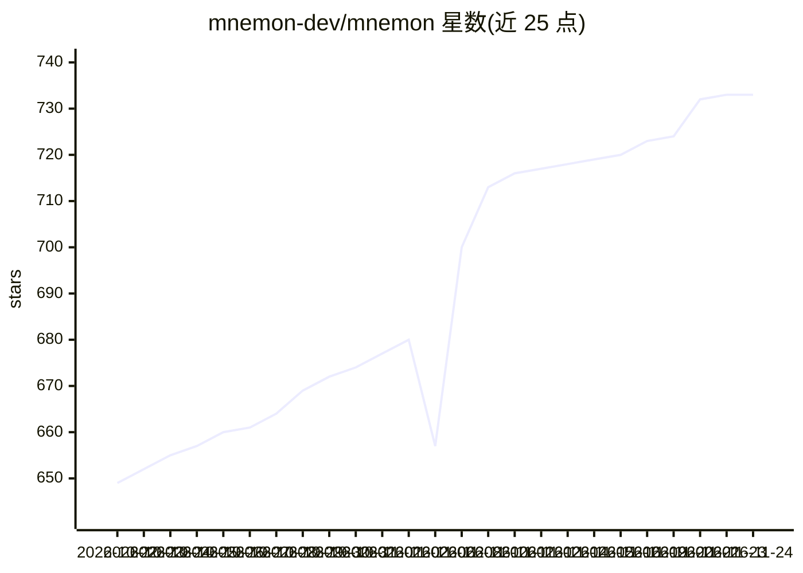

# mnemon-dev/mnemon

⭐ 737 · Go · Apache-2.0 · 推送 2026-11-23 · [GitHub](https://github.com/mnemon-dev/mnemon) · [官网](https://mnemon.dev) · 组织维护 · 中文 README

**给 AI agent 提供跨会话持久记忆的本地二进制工具**

以单个 Go 原生二进制形式提供的 LLM 监督式持久记忆工具：用四类图（时间/实体/语义/因果）存储知识，提供 remember/link/recall 三个原语、意图感知检索、重要性衰减与自动去重；由宿主 LLM 做记忆判断，二进制负责确定性计算。通过 setup 命令为 Claude Code、Codex、Cursor、OpenCode 等十余种 agent 运行时部署技能与生命周期钩子，另含本地 Web 工作台浏览记忆图。Windows 不支持 Agency 功能。

## 筛选速览

| 维度 | 判定 | 备注 |
|---|---|---|
| AI 角色 | `ai-ecosystem` | LLM/agent 周边工具 |
| 许可风险 | `permissive` | Apache-2.0 |
| 部署形态 | `self-host` | docker 或自建部署 |
| 模型依赖 | local-ok | 支持本地模型 |
| 硬件要求 | — | 无带数字的原话,不猜 |
| 安装摩擦 | `low` | 无编译、无系统依赖或容器化 |
| 成熟度 | — | 结构信号不足 |

## 能力要点

- 四图知识存储（时间/实体/语义/因果边）与意图感知检索、重要性衰减、自动去重
- LLM-Supervised 架构：宿主 LLM 做判断，二进制做存储/索引/检索，无需额外推理成本
- 一条 setup 命令为十余种 agent 运行时（Claude Code/Codex/Cursor/OpenCode/DSH 等）部署技能与钩子
- 内置本地 Web 工作台浏览记忆库、关系图与活动记录

## 适用场景

- 让编码 agent 在多次会话间保留关键决策与知识
- 为多个 agent 运行时统一接入同一套持久记忆
- 本地浏览和检索 agent 积累的知识图谱

## 场景标签

`Agent 记忆` `知识图谱` · 领域:Agent 开发

## 证据(README 行号)

> L16:  LLM-supervised persistent memory for AI agents.
> L24: Mnemon gives your agent persistent, cross-session memory — a four-graph knowledge store with intent-aware recall, i
> L35: Most memory tools embed their own LLM inside the pipeline. Mnemon takes a different approach: **your host LLM is th

## 星数曲线

2026-10-22 649 → 2026-11-24 733（+84）

---
*卡片 v1 · prompt 1.4 · 生成 2026-11-24 · 置信度 high · 依据 README sha `bffdbfa8c6c4` · [字段定义](../../DATASET.md)*
