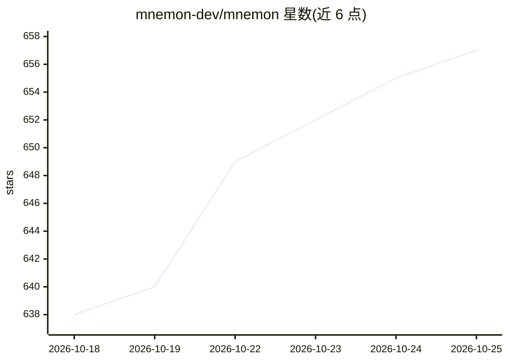

# mnemon-dev/mnemon

⭐ 660 · Go · Apache-2.0 · 推送 2026-10-19 · [GitHub](https://github.com/mnemon-dev/mnemon) · [官网](https://mnemon.dev) · 组织维护 · 中文 README

**给 AI agent 用的 LLM 监督式持久记忆：四图知识库与跨会话召回**

面向 LLM agent 的持久记忆工具：以单个本地二进制提供四图知识存储，含意图感知召回、重要性衰减与自动去重，跨会话保存决策与知识。设计上由宿主 LLM 充当监督者做判断（记什么/如何链接/何时遗忘），二进制负责存储、图索引、搜索等确定性计算，无需单独 API key。通过 remember/link/recall 三个原语交互，一条命令接入 Claude Code、Codex、Cursor、OpenCode、DeepSeek Harness 等十余种 agent 运行时，并附带本地 Web 知识浏览界面。Agency 预览功能在 Windows 上暂不可用。

## 筛选速览

| 维度 | 判定 | 备注 |
|---|---|---|
| AI 角色 | `ai-ecosystem` | LLM/agent 周边工具 |
| 许可风险 | `permissive` | Apache-2.0 |
| 部署形态 | `self-host` | docker 或自建部署 |
| 模型依赖 | locked-api |  |
| 硬件要求 | — | 无带数字的原话,不猜 |
| 安装摩擦 | `low` | 无编译、无系统依赖或容器化 |
| 成熟度 | `idea` | |

## 能力要点

- 四图知识存储：时序/实体/语义/因果边，带重要性衰减与自动去重
- LLM 监督架构：宿主 LLM 做判断，二进制做确定性计算，无额外推理成本
- 单二进制、零 API key，npm/brew/go install/源码多种安装途径
- 一条 setup 命令接入十余种 agent 运行时的技能与生命周期钩子

## 适用场景

- 让 Claude Code、Codex、Cursor 等编码 agent 跨会话记住项目决策与知识
- 通过本地 Web 界面浏览 agent 积累的记忆图谱与实体关系
- 为多种 agent 运行时统一部署持久记忆层

## 场景标签

`Agent 记忆` `知识图谱` · 领域:Agent 开发

## 证据(README 行号)

> L16:  LLM-supervised persistent memory for AI agents.
> L20: Mnemon gives your agent persistent, cross-session memory — a four-graph knowledge store with intent-aware recall, i
> L31: Most memory tools embed their own LLM inside the pipeline. Mnemon takes a different approach: **your host LLM is th

## 星数曲线

2026-10-18 638 → 2026-10-25 657（+19）

---
*卡片 v1 · prompt 1.4 · 生成 2026-10-21 · 置信度 mid · 依据 README sha `20e501d56b00` · [字段定义](../../DATASET.md)*
