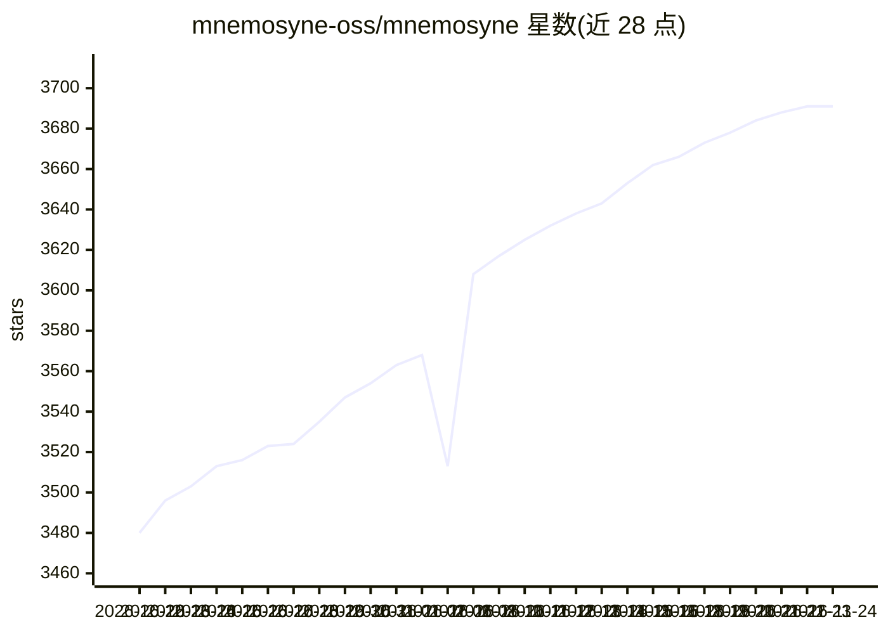

# mnemosyne-oss/mnemosyne

⭐ 3,694 · Python · MIT · 推送 2026-11-22 · [GitHub](https://github.com/mnemosyne-oss/mnemosyne) · [官网](https://mnemosyne.site) · 组织维护

**给 AI Agent 提供零云端本地记忆层的 SQLite 记忆库**

Mnemosyne 是一个通用记忆层（Hermes-first），通过 pip 安装并以单个 SQLite 数据库存储，无需外部服务。核心架构 BEAM 包含三层：工作记忆（调用 LLM 前自动注入、TTL 驱逐）、情景记忆（sqlite-vec + FTS5 混合检索）和 TripleStore 时序知识图谱。混合评分由 50% 向量相似度、30% FTS5 关键词、20% 重要度构成；嵌入经二值化压缩为 48 字节，全部检索在 SQLite 内完成。通过 MCP 服务器（stdio/SSE）、Python SDK、桥接文件等方式接入 Cursor、Claude Code、Codex、Windsurf、OpenWebUI 等 8+ 平台；支持可选双向同步与客户端加密，默认不向 OpenRouter 之外发送数据。

## 筛选速览

| 维度 | 判定 | 备注 |
|---|---|---|
| AI 角色 | `ai-ecosystem` | LLM/agent 周边工具 |
| 许可风险 | `permissive` | MIT |
| 部署形态 | `library` | 以包/库形式分发 |
| 模型依赖 | — | README 未给出锁定关系 |
| 硬件要求 | — | 无带数字的原话,不猜 |
| 安装摩擦 | `low` | 无编译、无系统依赖或容器化 |
| 成熟度 | — | 结构信号不足 |

## 能力要点

- BEAM 三层记忆：工作记忆自动注入、情景记忆混合检索、时序知识图谱
- 内置 MCP 服务器（stdio/SSE），覆盖 8+ agent 平台接入方式
- 嵌入二值化（384 维 → 48 字节），无外部向量数据库，检索全在 SQLite 内
- 可选端到端同步，支持客户端加密（Fernet / PyNaCl）

## 适用场景

- 给自建 agent 加长期记忆而不引入云服务
- 在 Cursor/Claude Code 等 MCP 客户端中保留用户偏好与历史事实
- 本地优先、需控制数据不出机的记忆存储

## 场景标签

`Agent 记忆` `知识图谱` · 领域:Agent 开发

## 证据(README 行号)

> L18: **Mnemosyne** is a universal, Hermes-first memory layer that works with any agent framework (Claude Code, Cursor, C
> L164: **BEAM** (Bilevel Episodic-Associative Memory):
> L179: |**MCP server**|✅ Built-in|❌|❌|❌|✅|✅|❌|

## 星数曲线

2026-10-22 3,480 → 2026-11-24 3,691（+211）

---
*卡片 v1 · prompt 1.4 · 生成 2026-11-23 · 置信度 high · 依据 README sha `d3ebceffed68` · [字段定义](../../DATASET.md)*
