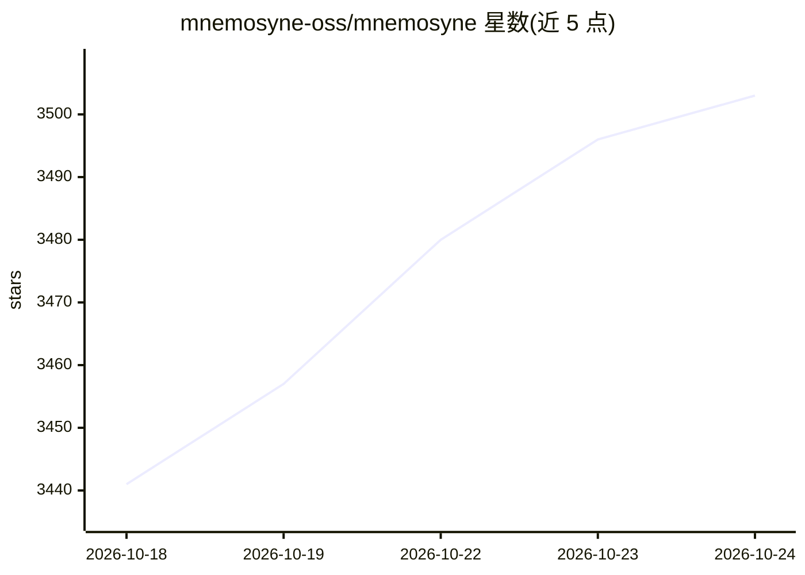

# mnemosyne-oss/mnemosyne

⭐ 3,513 · Python · MIT · 推送 2026-10-24 · [GitHub](https://github.com/mnemosyne-oss/mnemosyne) · [官网](https://mnemosyne.site) · 组织维护

**给 AI agent 提供本地 SQLite 记忆层的 Python 库**

面向任意 agent 框架的通用记忆层：以单个 SQLite 数据库存放工作记忆、情景记忆与时序知识图谱三元存储，检索采用向量相似度+FTS5 关键词+重要度的混合打分，支持向量二值化压缩。通过 pip 安装，无外部服务依赖；接入方式覆盖 MCP（stdio/SSE）、Python SDK 及 OpenWebUI/OpenClaw/Hermes 等平台适配，Hermes Agent 为原生集成。支持可选端到端加密的双向同步；默认嵌入模型为英文优化，多语言需换模型。

## 筛选速览

| 维度 | 判定 | 备注 |
|---|---|---|
| AI 角色 | `ai-ecosystem` | LLM/agent 周边工具 |
| 许可风险 | `permissive` | MIT |
| 部署形态 | `library` | 以包/库形式分发 |
| 模型依赖 | — | README 未给出锁定关系 |
| 硬件要求 | — | 无带数字的原话,不猜 |
| 安装摩擦 | `low` | 无编译、无系统依赖或容器化 |
| 成熟度 | `idea` | |

## 能力要点

- SQLite 单文件承载三层记忆结构（工作/情景/知识图谱）
- 混合检索打分：50% 向量 + 30% FTS5 + 20% 重要度
- 内置 MCP server，兼容 8+ 平台（Cursor/Claude Code/Codex/Windsurf/OpenWebUI 等）
- 可选同步支持客户端侧加密，服务器只见元数据

## 适用场景

- 为我的 Claude Code / Cursor / 自研 agent 添加持久记忆
- 跨设备同步 agent 记忆且内容端到端加密
- 在无云服务的本地环境运行带记忆的 agent

## 场景标签

`Agent 记忆` · 领域:Agent 开发

## 证据(README 行号)

> L18: **Mnemosyne** is a universal, Hermes-first memory layer that works with any agent framework (Claude Code, Cursor, C
> L150: **Hybrid scoring:** 50% vector similarity + 30% FTS5 rank + 20% importance, all inside SQLite.
> L156: |Feature|Mnemosyne|mem0|Letta|Honcho|SuperMemory|Hindsight|ChromaDB|

## 星数曲线

2026-10-18 3,441 → 2026-10-24 3,503（+62）

---
*卡片 v1 · prompt 1.4 · 生成 2026-10-20 · 置信度 high · 依据 README sha `af6ae4e98d8f` · [字段定义](../../DATASET.md)*
