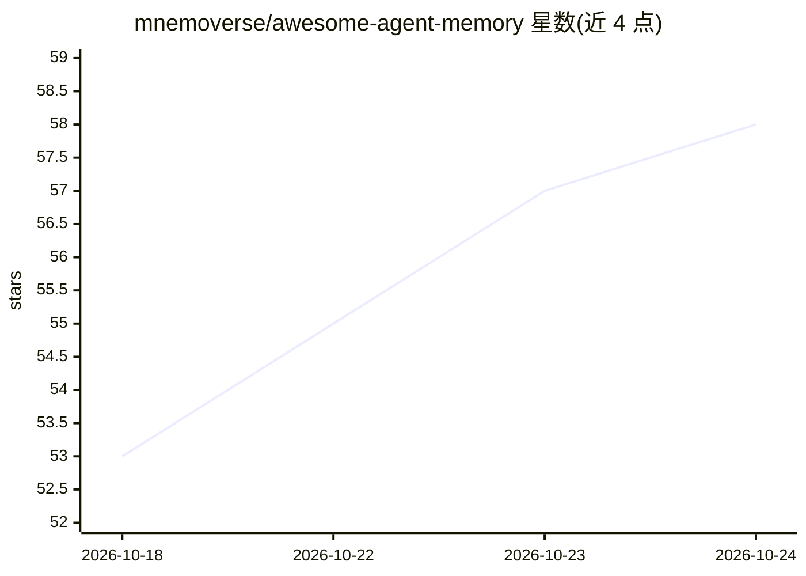

# mnemoverse/awesome-agent-memory

⭐ 58 · CC0-1.0 · 推送 2026-10-22 · [GitHub](https://github.com/mnemoverse/awesome-agent-memory) · 组织维护

**AI agent 记忆系统与研究的策展清单**

由 Mnemoverse 维护的 agent 记忆领域 awesome 清单，收录托管记忆 API/服务、开源框架与引擎、MCP 记忆服务器、评测基准与论文五类条目，每个条目附许可协议与机制简述。覆盖知识图谱记忆、本地 Markdown 记忆、用户画像记忆、时序知识图谱等多种记忆实现，并跟踪 LoCoMo、LongMemEval 等基准与 MemGPT、Mem0 等论文。清单本身以 CC0-1.0 发布，条目按字母排序，接受社区贡献。

## 筛选速览

| 维度 | 判定 | 备注 |
|---|---|---|
| AI 角色 | `ai-knowledge` | 知识聚合/清单类 |
| 许可风险 | `viral` | CC0-1.0 |
| 部署形态 | `None` |  |
| 模型依赖 | — | README 未给出锁定关系 |
| 硬件要求 | — | 无带数字的原话,不猜 |
| 安装摩擦 | `low` | 无编译、无系统依赖或容器化 |
| 成熟度 | — | 结构信号不足 |

## 能力要点

- 五个分区：托管服务、开源框架、MCP 记忆服务器、基准、论文
- 每条目标注许可协议与核心机制（如 bi-temporal 知识图谱、BM25 检索）
- 收录 6 个记忆评测基准（含 LoCoMo、LongMemEval 等）与 8 篇论文

## 适用场景

- 为 agent 项目选型记忆系统或 MCP 记忆服务器
- 查找记忆能力评测基准用于对比方案
- 跟踪 agent 记忆方向的研究论文脉络

## 场景标签

`精选清单` · 领域:学习与行业

## 证据(README 行号)

> L3: A curated list of memory systems, frameworks, benchmarks, and research for AI agents.
> L5: Agents forget between sessions and between tools. "Agent memory" is the growing category of systems that decide what

## 星数曲线

2026-10-18 53 → 2026-10-24 58（+5）

---
*卡片 v1 · prompt 1.4 · 生成 2026-10-24 · 置信度 high · 依据 README sha `e901f90474d0` · [字段定义](../../DATASET.md)*
