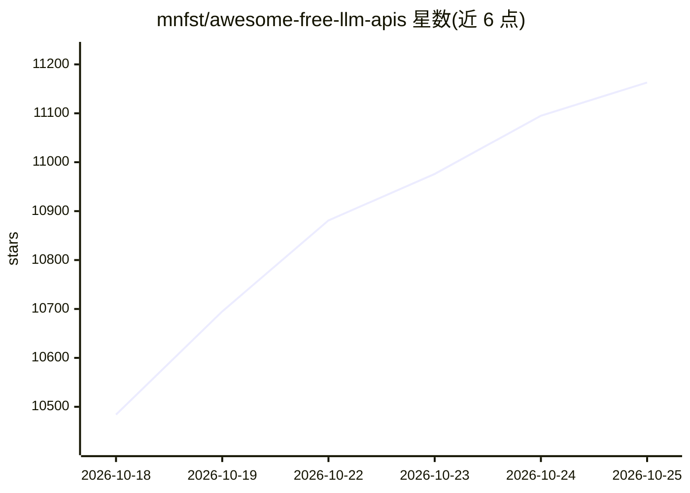

# mnfst/awesome-free-llm-apis

⭐ 11,163 · JavaScript · CC0-1.0 · 推送 2026-10-24 · [GitHub](https://github.com/mnfst/awesome-free-llm-apis) · 组织维护

**永久免费 LLM API 清单：按提供商列出可用模型与限额**

由 Manifest（manifest.build）维护的 awesome 清单，收录提供永久免费层级的 LLM API：按官方模型提供商（Cohere、Google Gemini、Mistral、Z AI 等）与第三方推理平台（Cloudflare Workers AI、Groq、Hugging Face、OpenRouter、Ollama Cloud、NVIDIA NIM 等）分组。每个条目给出 Base URL、免费额度条件、速率限制及模型表格（上下文长度、最大输出、模态）。README 声明所有端点默认兼容 OpenAI SDK，各链接指向提供商的 API key 页面，并在文内推广 Manifest 平台本身。清单不含本产品自身的安装步骤。

## 筛选速览

| 维度 | 判定 | 备注 |
|---|---|---|
| AI 角色 | `ai-knowledge` | 知识聚合/清单类 |
| 许可风险 | `viral` | CC0-1.0 |
| 部署形态 | `None` |  |
| 模型依赖 | — | README 未给出锁定关系 |
| 硬件要求 | — | 无带数字的原话,不猜 |
| 安装摩擦 | `low` | 无编译、无系统依赖或容器化 |
| 成熟度 | — | 结构信号不足 |

## 能力要点

- 覆盖官方提供商与第三方推理平台两类共十余个免费 API 来源
- 每个条目列出 Base URL、免费条件、速率限制与模型参数表
- 声明所有端点默认 OpenAI SDK 兼容
- 各条目附脚注引至提供商 API key 页面

## 适用场景

- 为个人项目或 agent 原型寻找零成本的 LLM API
- 比较各免费 API 的速率限制与上下文长度后选型
- 查找无需信用卡即可申请的 API key 渠道

## 场景标签

`精选清单` · 领域:学习与行业

## 证据(README 行号)

> L9:  LLM APIs with permanent free tiers for text inference.
> L27: APIs run by the companies that train or fine-tune the models themselves.

## 星数曲线

2026-10-18 10,484 → 2026-10-25 11,163（+679）

---
*卡片 v1 · prompt 1.4 · 生成 2026-10-20 · 置信度 high · 依据 README sha `eea92be95133` · [字段定义](../../DATASET.md)*
