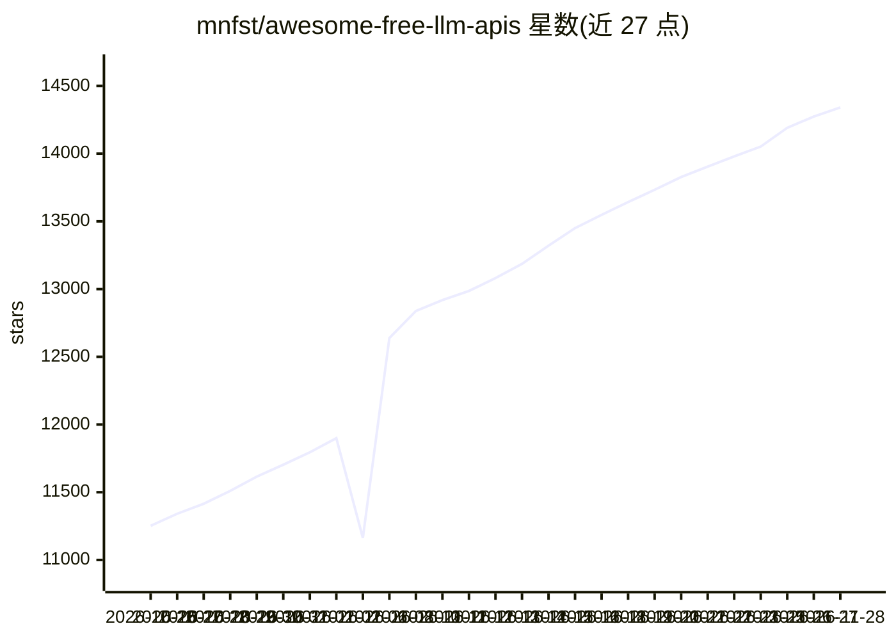

# mnfst/awesome-free-llm-apis

⭐ 14,341 · JavaScript · CC0-1.0 · 推送 2026-11-27 · [GitHub](https://github.com/mnfst/awesome-free-llm-apis) · 组织维护

**面向开发者的永久免费 LLM API 汇总清单**

以 awesome list 形式收录提供永久免费层级的 LLM 文本推理 API，分「Provider APIs」（模型训练方自营）与「Inference providers」（第三方托管开放权重模型）两类。每个条目给出 API key 获取入口、Base URL（含 OpenAI 兼容地址）以及模型上下文长度、最大输出、模态和速率限制表格。条目标注是否需要信用卡、实名验证等注册条件，部分条目以脚注引用来源。清单本身不提供代码或安装途径，仅供查询选型。

## 筛选速览

| 维度 | 判定 | 备注 |
|---|---|---|
| AI 角色 | `ai-knowledge` | 知识聚合/清单类 |
| 许可风险 | `viral` | CC0-1.0 |
| 部署形态 | `None` |  |
| 模型依赖 | — | README 未给出锁定关系 |
| 硬件要求 | — | 无带数字的原话,不猜 |
| 安装摩擦 | `low` | 无编译、无系统依赖或容器化 |
| 成熟度 | — | 结构信号不足 |

## 能力要点

- 区分 Provider APIs 与第三方 Inference providers 两类条目
- 每条给出 API key 页面链接、Base URL 与 OpenAI 兼容地址
- 表格列出模型上下文、最大输出、模态与速率限制
- 标注是否需要信用卡/验证等注册条件与免费额度

## 适用场景

- 为 Agent 或应用寻找零成本 LLM API 来源
- 按速率限制和上下文长度对比各免费层级的额度
- 查看某家模型方自营 API 与托管平台的免费接入条件

## 场景标签

`精选清单` · 领域:学习与行业

## 证据(README 行号)

> L9:  LLM APIs with permanent free tiers for text inference.
> L49: ## Provider APIs
> L51: APIs run by the companies that train or fine-tune the models themselves.

## 星数曲线

2026-10-26 11,252 → 2026-11-28 14,341（+3,089）

---
*卡片 v1 · prompt 1.4 · 生成 2026-11-28 · 置信度 high · 依据 README sha `b5edefd8a1ae` · [字段定义](../../DATASET.md)*
