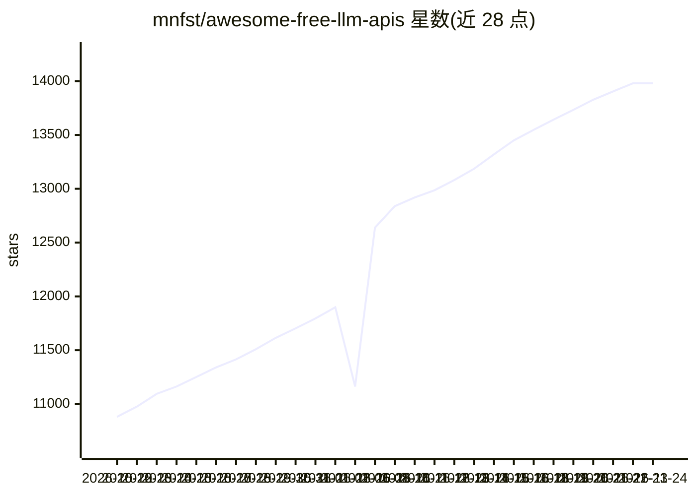

# mnfst/awesome-free-llm-apis

⭐ 13,980 · JavaScript · CC0-1.0 · 推送 2026-11-22 · [GitHub](https://github.com/mnfst/awesome-free-llm-apis) · 组织维护

**为开发者提供永久免费层 LLM API 的清单**

Awesome 格式的清单，收录带永久免费层的文本推理 LLM API：分「Provider APIs」（模型公司自营）与「Inference providers」（第三方托管平台）两类，每个条目列出免费额度、是否需信用卡、原生与 OpenAI 兼容的 Base URL，以及模型名、上下文长度、最大输出、模态与速率限制的表格，并附 RPM/RPD/TPM 等术语表与贡献指南。面向需要获取免费 API key 的开发者。

## 筛选速览

| 维度 | 判定 | 备注 |
|---|---|---|
| AI 角色 | `ai-knowledge` | 知识聚合/清单类 |
| 许可风险 | `viral` | CC0-1.0 |
| 部署形态 | `None` |  |
| 模型依赖 | — | README 未给出锁定关系 |
| 硬件要求 | — | 无带数字的原话,不猜 |
| 安装摩擦 | `low` | 无编译、无系统依赖或容器化 |
| 成熟度 | — | 结构信号不足 |

## 能力要点

- 按 Provider APIs 与 Inference providers 两类组织条目
- 每条列出免费额度、信用卡要求与 Base URL
- 标注各模型上下文、模态与速率限制
- 多数提供 OpenAI 兼容端点

## 适用场景

- 为个人项目寻找免费额度的 LLM API
- 对比各免费 API 的速率限制与模型覆盖
- 接入 OpenAI 兼容端点做本地开发测试

## 场景标签

`精选清单` · 领域:学习与行业

## 证据(README 行号)

> L9:  LLM APIs with permanent free tiers for text inference.
> L39: ## Provider APIs

## 星数曲线

2026-10-22 10,881 → 2026-11-24 13,980（+3,099）

---
*卡片 v1 · prompt 1.4 · 生成 2026-11-22 · 置信度 high · 依据 README sha `4a39145178e7` · [字段定义](../../DATASET.md)*
