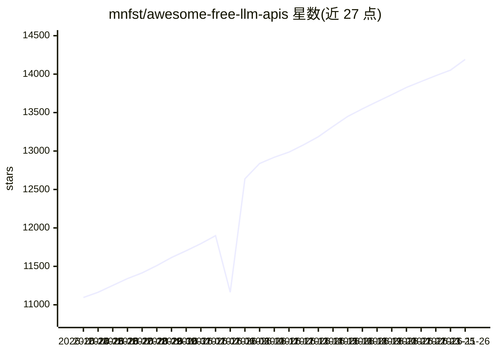

# mnfst/awesome-free-llm-apis

⭐ 14,191 · JavaScript · CC0-1.0 · 推送 2026-11-25 · [GitHub](https://github.com/mnfst/awesome-free-llm-apis) · 组织维护

**为开发者汇总提供永久免费层 LLM API 的清单**

一份 Awesome 风格的免费 LLM API 目录，按 Provider APIs（模型训练方自营）与 Inference providers（第三方推理托管）两类组织，逐条列出永久免费层的获取方式、API key 页链接、Base URL（多数提供 OpenAI 兼容端点）以及模型名、上下文长度、最大输出、模态与速率限制表格。目录覆盖 Aion Labs、Cohere、Gemini、Groq、OpenRouter 等十余家，并标注信用卡要求、配额与限制条件。README 不含安装与运行内容，仅作查阅目录使用；部分条目附脚注说明条款变化风险。

## 筛选速览

| 维度 | 判定 | 备注 |
|---|---|---|
| AI 角色 | `ai-knowledge` | 知识聚合/清单类 |
| 许可风险 | `viral` | CC0-1.0 |
| 部署形态 | `None` |  |
| 模型依赖 | — | README 未给出锁定关系 |
| 硬件要求 | — | 无带数字的原话,不猜 |
| 安装摩擦 | `low` | 无编译、无系统依赖或容器化 |
| 成熟度 | — | 结构信号不足 |

## 能力要点

- 逐家列出免费层的 Base URL 与 API key 获取链接
- 多数条目提供 OpenAI 兼容端点与原生端点两种 Base URL
- 每个模型给出上下文长度、最大输出、模态与速率限制表格
- 区分模型方自营 API 与第三方推理托管平台两类

## 适用场景

- 寻找无需信用卡的免费 LLM API 做开发原型
- 比较各家免费层模型的配额与速率限制
- 查看某家模型方或推理平台的免费模型列表与 Base URL

## 场景标签

`精选清单` · 领域:学习与行业

## 证据(README 行号)

> L9:  LLM APIs with permanent free tiers for text inference.
> L11:  Most providers offer an OpenAI-compatible endpoint. Native and compatible base URLs can differ. Each link points t
> L41: ## Provider APIs

## 星数曲线

2026-10-24 11,095 → 2026-11-26 14,191（+3,096）

---
*卡片 v1 · prompt 1.4 · 生成 2026-11-24 · 置信度 high · 依据 README sha `7bd3098a1f30` · [字段定义](../../DATASET.md)*
