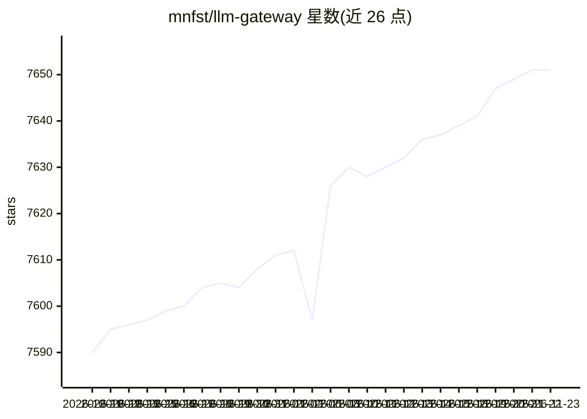

# mnfst/llm-gateway

⭐ 7,651 · TypeScript · MIT · 推送 2026-11-22 · [GitHub](https://github.com/mnfst/llm-gateway) · [官网](https://manifest.build) · 组织维护

**面向 AI agent 与应用的开源 LLM 网关：统一接入多提供商与本地模型**

Manifest LLM Gateway 是一个自托管或云端部署的 LLM 网关，将 API key、订阅账号与本地模型统一到 OpenAI 兼容端点，查询自动路由到对应模型。内置 35 个提供商连接与 18 种订阅流程，支持自定义路由、成功与错误的完整请求日志、成本追踪与限额通知，以及查询失败时切换到其他模型的 fallback。提供 Docker 镜像与 Railway/Render/AWS/GCP 等一键部署模板，npm 自托管路径已不再支持；云端版本收费 $19/月，自托管免费。

## 筛选速览

| 维度 | 判定 | 备注 |
|---|---|---|
| AI 角色 | `ai-ecosystem` | LLM/agent 周边工具 |
| 许可风险 | `permissive` | MIT |
| 部署形态 | `self-host` | docker 或自建部署 |
| 模型依赖 | local-ok | 支持本地模型 |
| 硬件要求 | — | 无带数字的原话,不猜 |
| 安装摩擦 | `low` | 无编译、无系统依赖或容器化 |
| 成熟度 | — | 结构信号不足 |

## 能力要点

- 统一 OpenAI 兼容端点，接入 300+ 模型与 35 个内置提供商连接
- 支持 API key、18 种订阅流程与本地模型（Ollama/LM Studio/llama.cpp）三种接入方式
- 成本逐笔追踪、限额与通知设置
- 查询失败时自动 fallback 到其他模型

## 适用场景

- 为 AI agent 提供多模型路由，避免单一提供商锁定
- 集中记录并追踪各应用的 LLM 调用成本
- 自托管网关统一管理团队 API key 与订阅账号

## 场景标签

`模型网关` · 领域:Agent 开发

## 证据(README 行号)

> L30: Manifest LLM Gateway is an open-source LLM gateway for AI agents and apps. Connect your API keys, subscriptions, an
> L71: Manifest connects to **300+ models through 35 built-in provider connections** plus any custom OpenAI/Anthropic-comp
> L45: Manifest ships as a Docker image. One command:

## 星数曲线

2026-10-21 7,590 → 2026-11-23 7,651（+61）

---
*卡片 v1 · prompt 1.4 · 生成 2026-11-22 · 置信度 high · 依据 README sha `7f7d5f34ba3f` · [字段定义](../../DATASET.md)*
