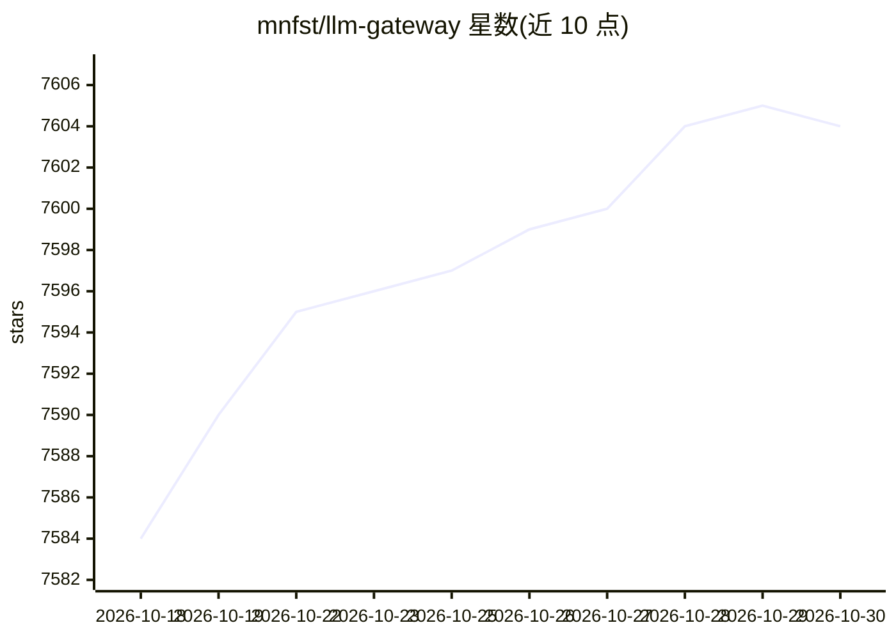

# mnfst/llm-gateway

⭐ 7,604 · TypeScript · MIT · 推送 2026-10-29 · [GitHub](https://github.com/mnfst/llm-gateway) · [官网](https://manifest.build) · 组织维护

**面向 AI agent 的开源 LLM 网关：统一端点路由与计费**

开源 LLM 网关，供 AI agent 与应用接入：将 API key、订阅与本地模型汇聚到一个 OpenAI 兼容端点，按查询路由到对应模型，支持 model=auto 自动选型、查询失败时跨模型回退、全量请求日志（成功与错误）、逐笔成本追踪与限额通知。内置 35 个 provider 连接（含 OpenAI/Anthropic/Google/Bedrock/Ollama/llama.cpp 等），覆盖 300+ 模型，另支持自定义 OpenAI/Anthropic 兼容端点。以 Docker 镜像自托管（旧 npm 方式不再支持），并提供 Railway/Render/AWS/GCP 等一键部署模板。

## 筛选速览

| 维度 | 判定 | 备注 |
|---|---|---|
| AI 角色 | `ai-ecosystem` | LLM/agent 周边工具 |
| 许可风险 | `permissive` | MIT |
| 部署形态 | `self-host` | docker 或自建部署 |
| 模型依赖 | local-ok | 支持本地模型 |
| 硬件要求 | — | 无带数字的原话,不猜 |
| 安装摩擦 | `low` | 无编译、无系统依赖或容器化 |
| 成熟度 | — | 结构信号不足 |

## 能力要点

- 单一 OpenAI 兼容端点统一接入 API key、订阅与本地模型
- 300+ 模型经 35 个内置 provider 连接，含 18 种订阅复用通道
- 跨模型失败回退与请求自修复
- 全量请求体日志与逐笔成本追踪、限额通知

## 适用场景

- 多 provider 场景下统一管理 AI 应用的模型调用入口
- 复用现有订阅额度避免按 token 付费
- 追踪与限制 agent 应用的 LLM 成本
- 本地 Ollama / llama.cpp 与云端模型混合路由

## 场景标签

`模型网关` `LLM 可观测性` · 领域:Agent 开发

## 证据(README 行号)

> L30: Manifest LLM Gateway is an open-source LLM gateway for AI agents and apps. Connect your API keys, subscriptions, an
> L71: Manifest connects to **300+ models through 35 built-in provider connections** plus any custom OpenAI/Anthropic-comp

## 星数曲线

2026-10-18 7,584 → 2026-10-30 7,604（+20）

---
*卡片 v1 · prompt 1.4 · 生成 2026-10-20 · 置信度 high · 依据 README sha `f0f86ae02e33` · [字段定义](../../DATASET.md)*
