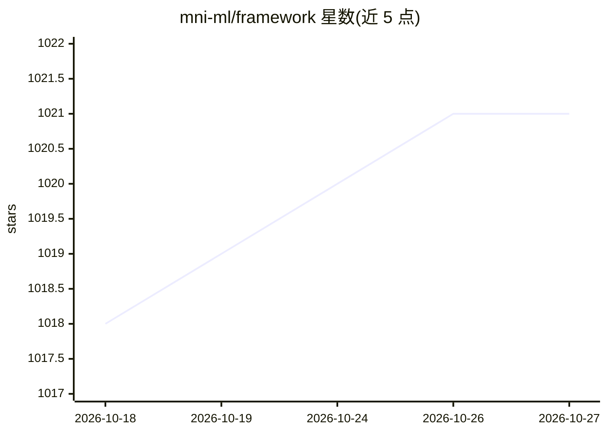

# mni-ml/framework

⭐ 1,021 · Rust · MIT · 推送 2026-04-20 · [GitHub](https://github.com/mni-ml/framework) · [官网](http://mni.ml) · 个人维护

**TypeScript 机器学习框架：Rust 后端支持 CPU/CUDA/WebGPU**

提供 PyTorch 风格 TypeScript API 的机器学习框架，底层为 Rust 原生后端（CPU、CUDA、WebGPU），实现自动微分、张量运算、神经网络模块（Linear/Conv/Embedding 等）与 SGD/Adam 优化器，用于在 Node 环境进行 GPU 加速训练。通过 N-API 桥接调用 Rust；三个后端共享同一 autograd tape，feature flags 编译时互斥，CPU 为默认无需 GPU。构建初衷为理解 ML 框架与模型的内部机制。npm 安装，MIT 许可。

## 筛选速览

| 维度 | 判定 | 备注 |
|---|---|---|
| AI 角色 | `ai-ecosystem` | LLM/agent 周边工具 |
| 许可风险 | `permissive` | MIT |
| 部署形态 | `library` | 以包/库形式分发 |
| 模型依赖 | — | README 未给出锁定关系 |
| 硬件要求 | `cpu-ok` | |
| 安装摩擦 | `medium` | 含编译或系统依赖之一 |
| 成熟度 | — | 结构信号不足 |

## 能力要点

- autograd tape 全反向传播自动微分
- CUDA (NVIDIA) 与 WebGPU (Metal/Vulkan/DX12) 后端
- PyTorch 风格 Tensor/Module/Parameter API 与 SGD/Adam 优化器
- 三后端共享同一 autograd tape，编译期 feature flags 互斥

## 适用场景

- 在 Node.js/TypeScript 项目中训练神经网络
- 用 NVIDIA CUDA 或 WebGPU 加速张量运算
- 学习 ML 框架内部实现机制

## 场景标签

`模型训练` · 领域:训练与推理

## 证据(README 行号)

> L3: A TypeScript ML framework with Rust native backends (CPU, CUDA, WebGPU) providing autograd, tensor operations, and n
> L9: - **GPU acceleration** -- CUDA (NVIDIA) and WebGPU (Metal/Vulkan/DX12) backends

## 星数曲线

2026-10-18 1,018 → 2026-10-27 1,021（+3）

---
*卡片 v1 · prompt 1.4 · 生成 2026-10-21 · 置信度 high · 依据 README sha `3ea69b62be6c` · [字段定义](../../DATASET.md)*
