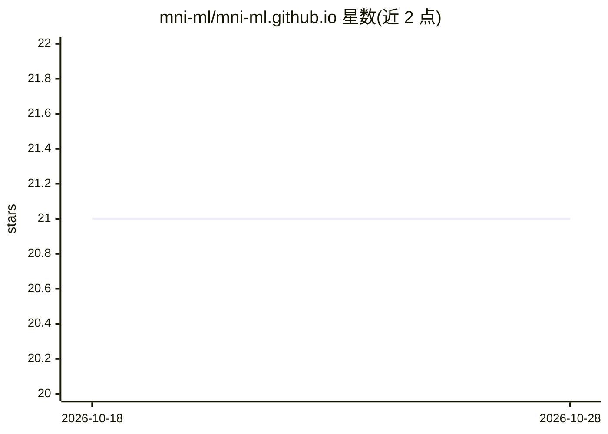

# mni-ml/mni-ml.github.io

⭐ 21 · TypeScript · 推送 2026-05-02 · [GitHub](https://github.com/mni-ml/mni-ml.github.io) · [官网](https://mni-ml.github.io/) · 个人维护

**从零构建机器学习的课程式技术博客，附浏览器推理演示**

课程式博客网站，按从基础到完整模型训练的顺序讲解机器学习：涵盖 ML 基础、梯度下降与自动微分、CUDA 与 GPU 计算、Transformers 架构及在 TinyStories 上从零训练语言模型。所有实现基于自研的 @mni-ml/framework（TypeScript ML 框架，带 Rust 原生后端）。提供交互演示：一个 12M 参数的 GPT 在浏览器中通过纯 TypeScript Web 后端运行推理，实时展示 next-token 预测概率分布。网站基于 Astro 构建，文章用 Notion 编写并在构建时通过自定义内容加载器拉取。开发需 pnpm。

## 筛选速览

| 维度 | 判定 | 备注 |
|---|---|---|
| AI 角色 | `ai-knowledge` | 知识聚合/清单类 |
| 许可风险 | `none` | — |
| 部署形态 | `library` | 以包/库形式分发 |
| 模型依赖 | — | README 未给出锁定关系 |
| 硬件要求 | — | 无带数字的原话,不猜 |
| 安装摩擦 | `medium` | 含编译或系统依赖之一 |
| 成熟度 | — | 结构信号不足 |

## 能力要点

- 从零实现方式的 ML 课程（数学+直觉+代码）
- 自研 TypeScript ML 框架（Rust 原生后端）支撑全部实现
- 12M 参数 GPT 浏览器内推理演示，实时显示 token 概率分布
- 覆盖梯度下降、CUDA/GPU 计算、Transformers 训练

## 适用场景

- 系统学习从数学原理到实现的机器学习
- 观察语言模型 next-token 预测的概率分布
- 了解 GPU 并行与 CUDA 在 ML 框架中的应用

## 场景标签

`教程课程` · 领域:学习与行业

## 证据(README 行号)

> L11: mni-ml is a curriculum-style blog that teaches machine learning from the ground up. Rather than treating models as 
> L17: - **Intro to ML** — What machine learning is, how models learn from data, and the core loop of prediction, loss, an

## 星数曲线

2026-10-18 21 → 2026-10-28 21（+0）

---
*卡片 v1 · prompt 1.4 · 生成 2026-10-28 · 置信度 high · 依据 README sha `9072fe089315` · [字段定义](../../DATASET.md)*
