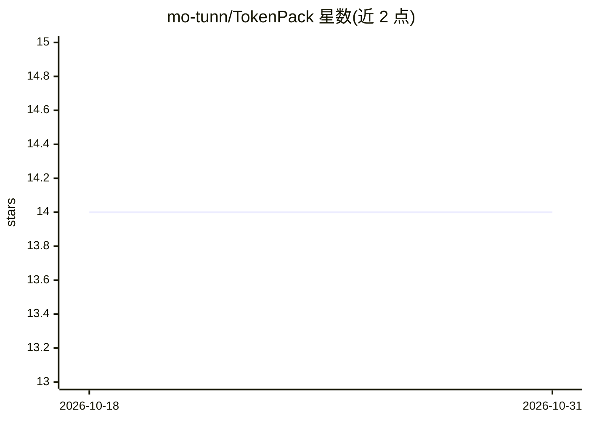

# mo-tunn/TokenPack

⭐ 14 · Python · NOASSERTION · 推送 2026-10-16 · [GitHub](https://github.com/mo-tunn/TokenPack) · 个人维护

**把长文档/代码库/PDF 打包为预算内紧凑 LLM 上下文的 CLI**

面向开发者的上下文打包工具：将文档、代码、PDF、表格或整个文件夹按标题/段落/语义切分，用本地嵌入模型（all-MiniLM-L6-v2）加证据评分对 chunk 排序，在 token 预算内贪心填充，输出 Markdown 上下文文件供任意 LLM 或 agent 使用；打包过程不调用 LLM，可选叠加 LLMLingua/LongLLMLingua 压缩。以 pip 包与 CLI 提供，支持本地 stdio MCP 服务器（pack_context / read_packed_context 两个工具），预算可手动或自动估算。实验数据自述为探索性试点，非统计确立结论。采用 Business Source License 1.1。

## 筛选速览

| 维度 | 判定 | 备注 |
|---|---|---|
| AI 角色 | `ai-ecosystem` | LLM/agent 周边工具 |
| 许可风险 | `none` | NOASSERTION |
| 部署形态 | `library` | 以包/库形式分发 |
| 模型依赖 | — | README 未给出锁定关系 |
| 硬件要求 | — | 无带数字的原话,不猜 |
| 安装摩擦 | `low` | 无编译、无系统依赖或容器化 |
| 成熟度 | — | 结构信号不足 |

## 能力要点

- 结构感知切分 + 证据混合评分 + 预算贪心打包，打包时不调用 LLM
- 本地嵌入模型 all-MiniLM-L6-v2，支持 --offline-models
- 可作为本地 stdio MCP 服务器供 agent 使用，默认限定 --workspace 读写
- 支持 PDF/Office/代码/数据配置等多类输入（部分需安装 extras）

## 适用场景

- 把整篇论文或整个代码仓库压缩成能贴给 LLM 的上下文文件
- 让 agent 通过 MCP 读取大型本地工作区而无需上传全部内容
- 在固定 token 预算下保留与查询最相关的证据片段

## 场景标签

`RAG` · 领域:知识与检索

## 证据(README 行号)

> L14: TokenPack-RAG selects the most useful parts of documents, code, PDFs, tables, and folders under a strict token budg
> L39: - Helps agents work with large local workspaces through MCP without uploading everything.

## 星数曲线

2026-10-18 14 → 2026-10-31 14（+0）

---
*卡片 v1 · prompt 1.4 · 生成 2026-10-31 · 置信度 high · 依据 README sha `4059651d8c46` · [字段定义](../../DATASET.md)*
