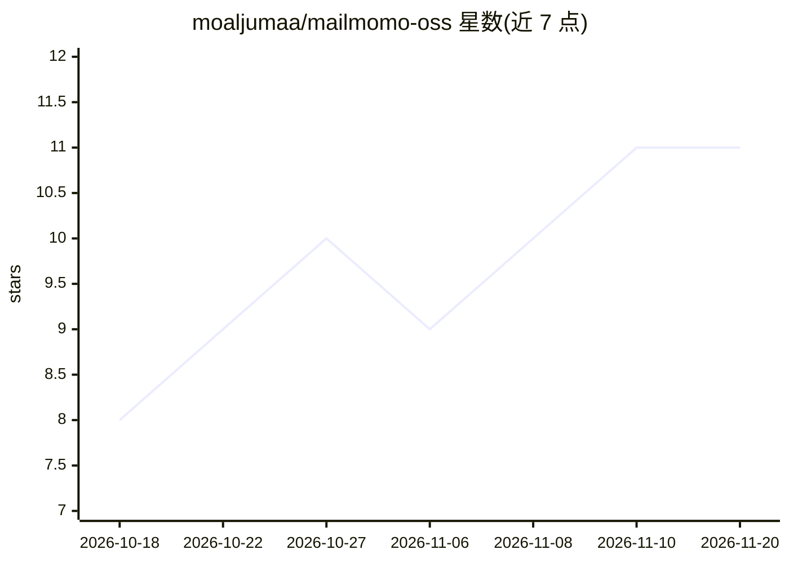

# moaljumaa/mailmomo-oss

⭐ 11 · TypeScript · AGPL-3.0 · 推送 2026-10-16 · [GitHub](https://github.com/moaljumaa/mailmomo-oss) · 个人维护

**自托管、键盘优先的 AI 邮件客户端，支持任意 IMAP/SMTP 账户**

自托管的邮件客户端，通过 IMAP/SMTP 收发邮件（示例含 AWS SES），用 SQLite 做本地缓存，支持双向同步（IDLE/CONDSTORE）、全文搜索、会话线程、撤销发送、定时发送等。AI 部分需设置 LLM_API_KEY：到件自动分诊、线程摘要、三种语气的智能回复、自然语言搜索与规则、Ask AI 助手（只读不发送）。内置 MCP 服务器提供约 45 个工具供外部 AI 助手接入，token 分 read/organize/full 三档权限并审计。v1 限制包括草稿/标签仅存本地、AI 分诊仅覆盖近 14 天邮件、仅密码认证。

## 筛选速览

| 维度 | 判定 | 备注 |
|---|---|---|
| AI 角色 | `ai-enhanced` | 去掉 AI 部分产品仍成立 |
| 许可风险 | `viral` | AGPL-3.0 |
| 部署形态 | `self-host` | docker 或自建部署 |
| 模型依赖 | — | README 未给出锁定关系 |
| 硬件要求 | — | 无带数字的原话,不猜 |
| 安装摩擦 | `low` | 无编译、无系统依赖或容器化 |
| 成熟度 | — | 结构信号不足 |

## 能力要点

- 内置 MCP 服务器（约 45 个工具），带 token 分级与审计日志
- AI 自动分诊、线程摘要、智能回复草稿与自然语言规则（无 API key 时功能降级可用）
- IMAP 双向同步：IDLE 推送、CONDSTORE、全邮箱后台回填，离线操作经持久队列重放
- 安全模型：HTML 消毒沙箱渲染、密码 AES-256-GCM 加密、追踪像素默认拦截

## 适用场景

- 将 Gmail/Outlook/iCloud 等多个邮箱统一到自己的服务器上管理
- 让 Claude 等外部 AI 助手通过 MCP 读写和整理自己的收件箱
- 用自然语言规则自动归档、打标签，清理积压邮件

## 场景标签

 · 领域:办公效率/邮件

## 证据(README 行号)

> L2:  The calm, AI-native email client you self-host.
> L29: **AI at the core** (set `LLM_API_KEY`; everything degrades gracefully without it)
> L41: **MCP server** (`/api/mcp`, Streamable HTTP): ~45 tools — list/search/read, summarize, label, archive, snooze, draf

## 星数曲线

2026-10-18 8 → 2026-11-20 11（+3）

---
*卡片 v1 · prompt 1.4 · 生成 2026-11-18 · 置信度 high · 依据 README sha `f48211c021e3` · [字段定义](../../DATASET.md)*
