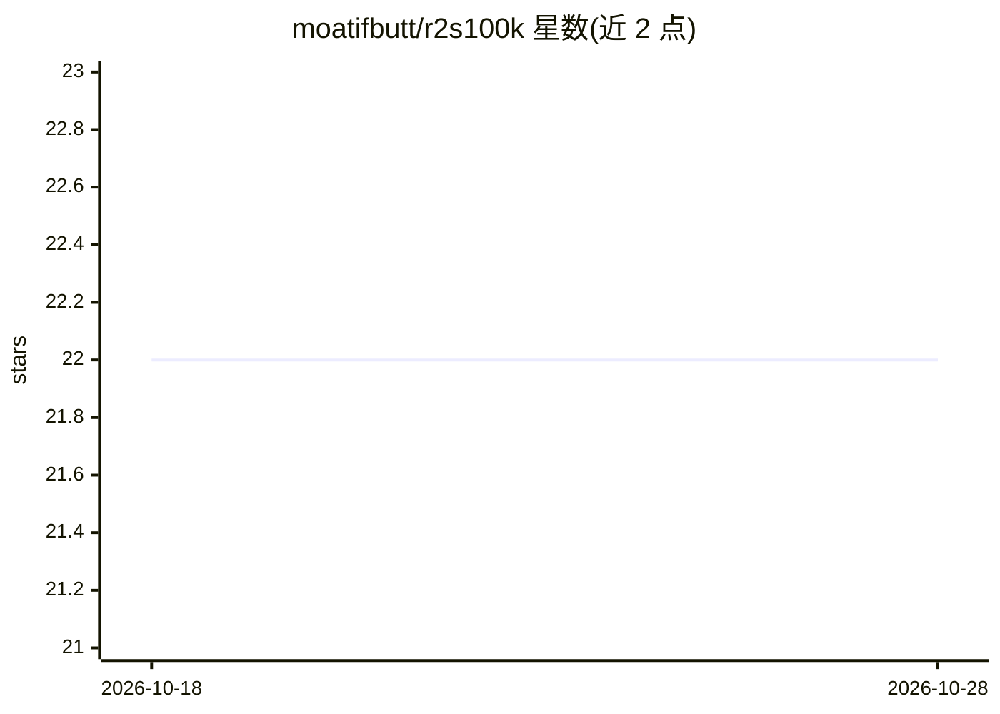

# moatifbutt/r2s100k

⭐ 22 · Jupyter Notebook · 推送 2026-01-28 · [GitHub](https://github.com/moatifbutt/r2s100k) · [官网](https://r2s100k.github.io/) · 组织维护

**非结构化道路分割数据集与半监督训练基准（14,000+ 标注图）**

面向野外非结构化道路场景的大规模道路区域分割数据集与基准：14000 余张标注图像、14 个细分类别（沥青安全区、湿滑、砾石、泥沼、植被、积水、减速带等），发表于 IJCV 2024。配套代码提供基于高效数据采样（EDS）的师生自训练框架：先训练教师模型，对无标注集生成伪标签，再训练学生模型。提供图像与视频的像素级分割测试脚本。数据集需邮件申请获取，未标注数据尚未发布。

## 筛选速览

| 维度 | 判定 | 备注 |
|---|---|---|
| AI 角色 | `ai-knowledge` | 知识聚合/清单类 |
| 许可风险 | `none` | — |
| 部署形态 | `library` | 以包/库形式分发 |
| 模型依赖 | — | README 未给出锁定关系 |
| 硬件要求 | — | 无带数字的原话,不猜 |
| 安装摩擦 | `low` | 无编译、无系统依赖或容器化 |
| 成熟度 | — | 结构信号不足 |

## 能力要点

- 14000+ 标注图像、14 个道路区域细分类别
- EDS 高效数据采样 + 师生伪标签半监督训练框架
- 图像与视频的像素级分割推理脚本
- IJCV 2024 接收论文配套数据集

## 适用场景

- 自动驾驶在非结构化道路上做道路可行驶区域分割
- 半监督语义分割方法的训练与评测基准
- 对图像或视频执行道路区域像素级分割

## 场景标签

`模型评测` `目标检测` · 领域:评测与运维

## 证据(README 行号)

> L1: # R2S100K: Road-Region Segmentation Dataset For Semi-Supervised Autonomous Driving in the Wild [Accepted in IJCV 202
> L19: We present a large-scale R2S100K dataset to train and evaluate supervised/semi-supervised methods in challenging ro

## 星数曲线

2026-10-18 22 → 2026-10-28 22（+0）

---
*卡片 v1 · prompt 1.4 · 生成 2026-10-27 · 置信度 mid · 依据 README sha `8b90c82e77b0` · [字段定义](../../DATASET.md)*
