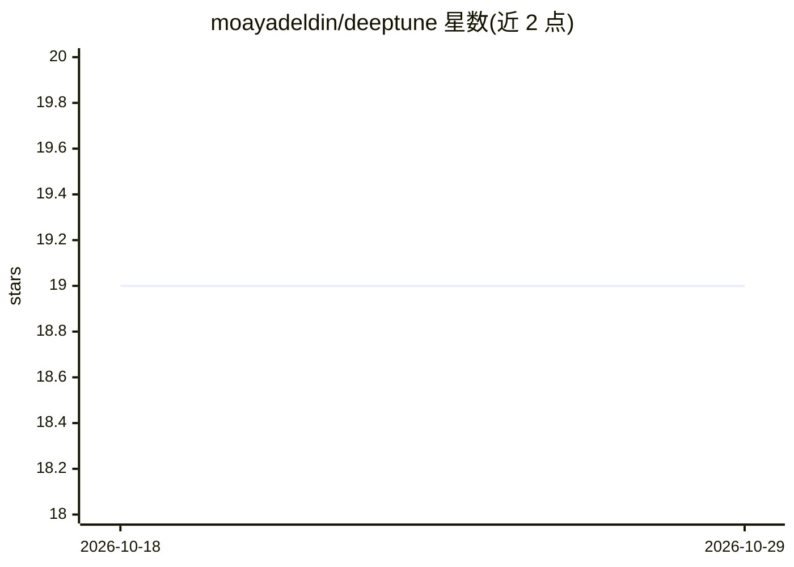

# moayadeldin/deeptune

⭐ 19 · Python · 推送 2026-10-18 · [GitHub](https://github.com/moayadeldin/deeptune) · 组织维护

**面向学生的 AutoML CLI：一条命令微调深度模型**

DeepTune 是一个自动化深度学习（AutoML）库与 CLI 工具，覆盖图像、文本、表格与时序四类模态：对 ResNet/DenseNet/Swin/EfficientNet/VGG/ViT/SiGLiP 做带可调嵌入层的迁移学习，对 GPT-2、BERT 做文本分类与情感分析，对 GANDALF、TabPFN 做端到端训练，对 DeepAR 做时序预测；支持 PEFT（LoRA）以降低算力需求。最初面向加拿大 StFX 大学计算机系本科生与研究生社区发布，附文档与演示视频。README 未给出具体安装命令，安装信息需查阅其文档。

## 筛选速览

| 维度 | 判定 | 备注 |
|---|---|---|
| AI 角色 | `ai-native` | 本体是模型或模型工具 |
| 许可风险 | `none` | — |
| 部署形态 | `None` |  |
| 模型依赖 | — | README 未给出锁定关系 |
| 硬件要求 | — | 无带数字的原话,不猜 |
| 安装摩擦 | `low` | 无编译、无系统依赖或容器化 |
| 成熟度 | — | 结构信号不足 |

## 能力要点

- 一条 CLI 命令完成跨模态（图像/文本/表格/时序）模型微调与训练
- 支持多种视觉与语言预训练模型的迁移学习与嵌入提取
- 视觉算法支持 PEFT with LoRA，可在低算力设备上运行
- 表格（GANDALF/TabPFN）与时序（DeepAR）端到端训练

## 适用场景

- 对图像或文本数据集做分类任务的模型微调
- 低算力设备上用 LoRA 微调视觉模型
- 教学场景中学生快速上手深度学习实验
- 表格与时序数据的端到端训练与预测

## 场景标签

`微调` · 领域:训练与推理

## 证据(README 行号)

> L6: ***DeepTune*** is a full compatible library to automate Computer Vision, Natural Language Processing, Tabular, and T
> L20: - Fine-tuning state-of-the-art Computer Vision algorithms (ResNet, DenseNet, etc.) for image classification.
> L21: - Fine-tuning state-of-the-art NLP (BERT, GPT-2) algorithms for text classification.
> L22: - End-to-end training for tabular and time-series algorithms.

## 星数曲线

2026-10-18 19 → 2026-10-29 19（+0）

---
*卡片 v1 · prompt 1.4 · 生成 2026-10-28 · 置信度 mid · 依据 README sha `078a20290953` · [字段定义](../../DATASET.md)*
