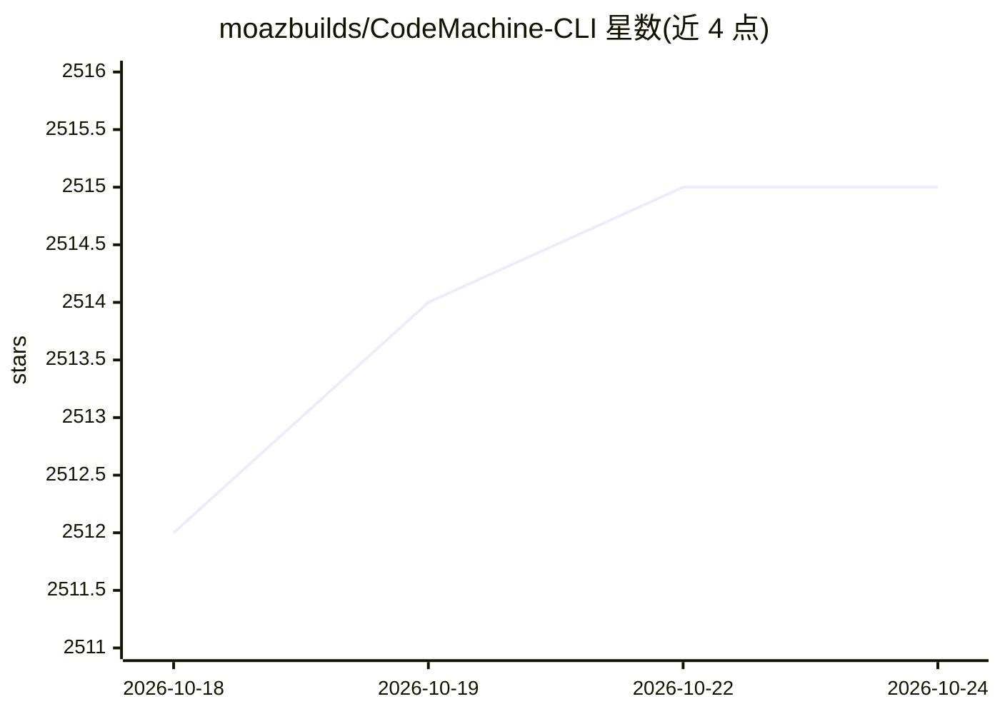

# moazbuilds/CodeMachine-CLI

⭐ 2,515 · TypeScript · Apache-2.0 · 推送 2026-02-25 · [GitHub](https://github.com/moazbuilds/CodeMachine-CLI) · [官网](https://codemachine.co/) · 个人维护

**将 AI 编码代理编排为可复用长时工作流的 CLI 工具**

npm 全局安装的命令行编排层，调用 AI 编码 CLI（Claude Code、Codex、Cursor 等）的无头脚本模式，把开发者脑中的编码流程定义为结构化工作流，由工具负责执行、上下文传递与多代理协调。支持从全交互到全自主的工作流、多代理并行执行、可运行数小时到数天的长时任务及持久化，并提供集中式提示与动态上下文管理。附默认的 Ali Workflow Builder 工作流供交互式创建首个工作流。

## 筛选速览

| 维度 | 判定 | 备注 |
|---|---|---|
| AI 角色 | `ai-ecosystem` | LLM/agent 周边工具 |
| 许可风险 | `permissive` | Apache-2.0 |
| 部署形态 | `library` | 以包/库形式分发 |
| 模型依赖 | — | README 未给出锁定关系 |
| 硬件要求 | — | 无带数字的原话,不猜 |
| 安装摩擦 | `low` | 无编译、无系统依赖或容器化 |
| 成熟度 | — | 结构信号不足 |

## 能力要点

- 通过无头脚本模式调用 Claude Code、Codex、Cursor 等编码引擎
- 多代理编排：任务分配、代理间通信与协作
- 并行执行与长时运行工作流的持久化支持
- 集中式提示与动态上下文管理，控制每步代理可见内容

## 适用场景

- 把修 bug、做功能等重复性编码流程固化为可复用工作流
- 让多个 AI 代理并行处理大型任务的不同部分
- 运行需持续数小时到数天的自主编码工作流

## 场景标签

`多智能体` `工作流自动化` `编码 Agent` · 领域:Agent 开发

## 证据(README 行号)

> L19: CodeMachine is an orchestration layer that runs AI coding CLIs through structured workflows. You define the workflo
> L21: It uses the headless scripting mode that AI coding engines provide for automation (Claude Code, Codex, Cursor, and 

## 星数曲线

2026-10-18 2,512 → 2026-10-24 2,515（+3）

---
*卡片 v1 · prompt 1.4 · 生成 2026-10-21 · 置信度 high · 依据 README sha `bdc29dfab213` · [字段定义](../../DATASET.md)*
