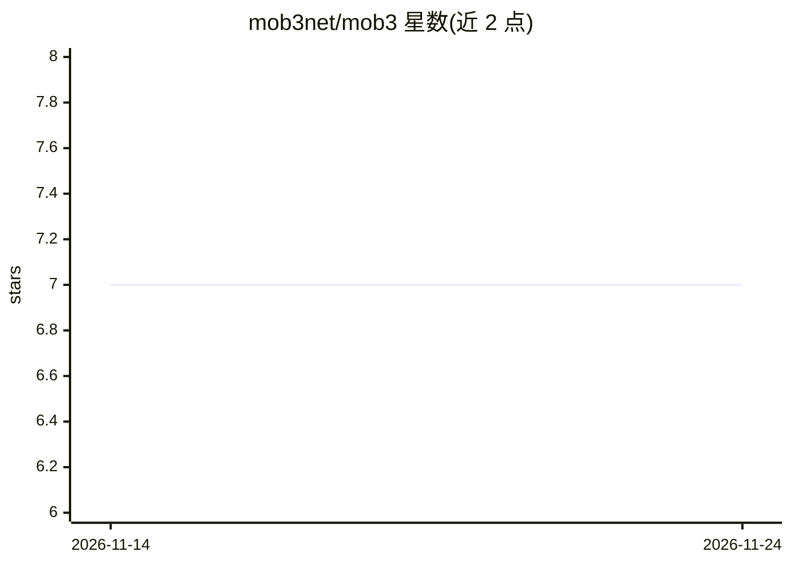

# mob3net/mob3

⭐ 7 · Go · AGPL-3.0 · 推送 2026-11-23 · [GitHub](https://github.com/mob3net/mob3) · [官网](https://mob3.net) · 个人维护

**面向 Vim 用户与 AI agent 的终端网页浏览器**

用 Go 编写的终端网页浏览器，自带 HTML 渲染引擎与 JavaScript 支持，含 ANSI 渲染与内联图片（kitty/iterm/blocks），无需 GUI 工具包。提供 Vimium 式链接提示、阅读模式、深色模式、内置 PDF 文本查看器与 JS 控制台。可通过 `-mcp` 以 stdin/stdout 运行无头 MCP 服务器，供脚本与 AI 工具导航、快照、点击、填表。定位为内容浏览器，对重 JS 应用与反爬页面支持受限，无视频/WebGL/iframe。提供 GitHub Releases 静态二进制、Docker 与源码构建。

## 筛选速览

| 维度 | 判定 | 备注 |
|---|---|---|
| AI 角色 | `ai-enhanced` | 去掉 AI 部分产品仍成立 |
| 许可风险 | `viral` | AGPL-3.0 |
| 部署形态 | `self-host` | docker 或自建部署 |
| 模型依赖 | — | README 未给出锁定关系 |
| 硬件要求 | — | 无带数字的原话,不猜 |
| 安装摩擦 | `low` | 无编译、无系统依赖或容器化 |
| 成熟度 | — | 结构信号不足 |

## 能力要点

- 自带 HTML 渲染引擎，支持 JavaScript、CSS、内联图片与文本 PDF 查看
- `-mcp` 无头模式以 MCP 服务器形式暴露 navigate/snapshot/click/evaluate 等工具
- Vimium 式链接提示、阅读模式、深色模式、会话内缓存
- GitHub Releases 提供多架构静态二进制，另支持 Docker 运行

## 适用场景

- 在终端里阅读文档、博客、新闻与维基页面
- 让 Claude Code、Cursor 等 AI 工具通过 MCP 控制无头浏览器抓取页面文本
- 在无法使用 GUI 的环境中浏览与截图网页

## 场景标签

`浏览器自动化` · 领域:效率与自动化

## 证据(README 行号)

> L3: # MOB³ is a small indie web browser for the terminal
> L136: - Headless MCP automation (`-mcp`): navigate, snapshot page text and links,
> L219: `mob3 -mcp` runs a headless browser as a Model Context Protocol server over

## 星数曲线

2026-11-14 7 → 2026-11-24 7（+0）

---
*卡片 v1 · prompt 1.4 · 生成 2026-11-20 · 置信度 high · 依据 README sha `499214c168dc` · [字段定义](../../DATASET.md)*
